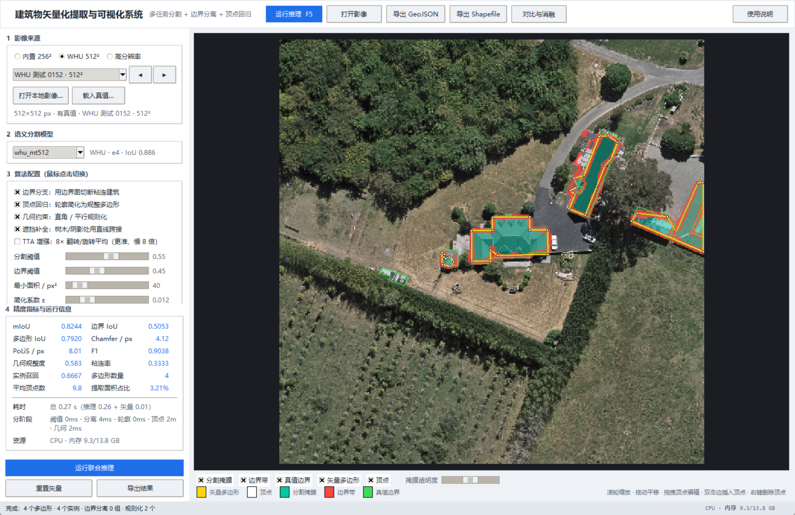
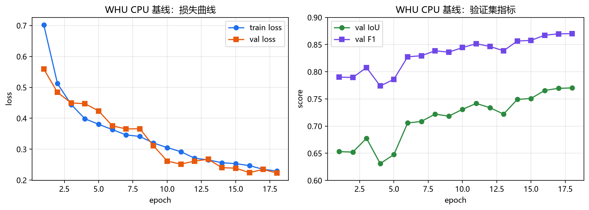
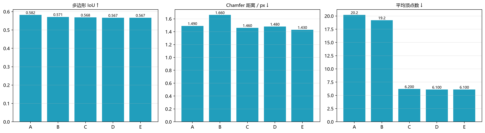

# 航拍图像建筑物自动提取：初步实验

本仓库是毕业设计课题的**可复现初步实验**，针对航拍建筑物提取中的四类困难：

- 光照变化（阴影、曝光不足）
- 遮挡与复杂背景（道路、植被、水体混淆）
- 尺度差异（小目标漏提、大建筑边界不完整）
- 密集区域粘连（相邻建筑被预测为一个连通域）

在公开的 **Massachusetts Buildings Dataset** 上，比较 U-Net 基线、多尺度特征融合、以及“多尺度 + 边界辅助监督”三组模型，并给出像素级、边界级与实例级（小目标召回、粘连率）的评价和失败案例分析。

## 1. 环境

本机实测环境：

| 项目 | 配置 |
|---|---|
| Python | 3.13.5（`.venv` 虚拟环境） |
| PyTorch | 2.14.1+cpu |
| CPU | AMD Ryzen 7 8845H（8 核 16 线程） |
| GPU | 无 CUDA，纯 CPU 训练 |
| 内存 | 14 GB |

```powershell
python -m venv .venv
.\.venv\Scripts\python.exe -m pip install -r requirements.txt
# CPU 版 PyTorch 建议单独安装：
.\.venv\Scripts\python.exe -m pip install torch --index-url https://download.pytorch.org/whl/cpu
```

## 2. 数据

使用 Mnih (2013) 的 Massachusetts Buildings Dataset（1 m 分辨率，1500×1500 航拍图，官方 train/valid/test 划分）：

```powershell
# 本实验为控制 CPU 成本，只取 40 张训练图 + 官方验证/测试集
.\.venv\Scripts\python.exe scripts\download_data.py --train 40 --valid 10 --test 10 --workers 3
.\.venv\Scripts\python.exe scripts\prepare_data.py --patch 256 --stride 256
```

切块后：训练 1325 张、验证 144 张、测试 360 张（256×256）。训练时随机抽取 900 张，并做翻转、旋转、亮度/对比度/Gamma/噪声增强。

> 数据仅用于科研，请引用：Mnih, V. *Machine Learning for Aerial Image Labeling*. PhD thesis, University of Toronto, 2013.

## 3. 方法

- **U-Net 基线**：4 级编码-解码，base=16，BCE + Dice。
- **+多尺度融合（MSF）**：瓶颈层加入 ASPP（膨胀率 1/2/4/8 + 全局池化），在同一层同时捕获近、中、远距离上下文，缓解尺度差异和密集区域粘连。
- **完整模型**：MSF + 边界辅助头。由真值形态学梯度生成边界带，额外用带正样本权重的 BCE 监督，提升边缘完整性。

## 4. 复现实验

```powershell
# 数据难度量化与总览图
.\.venv\Scripts\python.exe scripts\audit_dataset.py

# 三个模型（CPU 上每个约 15–25 分钟）
.\.venv\Scripts\python.exe scripts\train.py --model unet --epochs 12 --max-train 900 --base 16 --channels-last
.\.venv\Scripts\python.exe scripts\train.py --model msf  --epochs 12 --max-train 900 --base 16 --channels-last
.\.venv\Scripts\python.exe scripts\train.py --model full --epochs 12 --max-train 900 --base 16 --channels-last

# 在验证集上选阈值，在测试集上评价
.\.venv\Scripts\python.exe scripts\evaluate.py --models unet msf full --tune
.\.venv\Scripts\python.exe scripts\analyze_results.py
```

## 5. 输出

```
results/
  dataset_audit.json              # 光照/尺度/密度/背景复杂度统计
  metrics_<model>_test.json       # 总体指标
  model_summary.csv               # 三组模型汇总表
  per_image_<model>_test.csv      # 单图诊断（亮度、阴影、密度、IoU、小目标召回、粘连率）
  analysis_summary.json           # 分场景指标、相关系数、Bootstrap 区间
  figures/
    dataset_overview.png
    model_comparison.png
    training_curves.png
    difficulty_breakdown.png
    qualitative_comparison.png
    failure_cases.png
  geometry/
    vectorization_demo.png        # 朴素矢量化基线
    vector_metrics.json
    pipeline_diagnostic.png       # 四组配置的矢量结果对比（由 vectorize_diagnostic.py 生成）
  ablation/
    ablation_compare.csv          # 4 组配置 × 各模型 × 平均指标
    ablation_compare.json
    ablation_compare.png
runs/<model>/best.pt              # 验证集 IoU 最优权重
report/初步研究报告.md            # 中文初步研究报告
docs/可视化系统说明.md            # 可视化原型系统的使用与设计说明
```

## 6. 目录

```
src/           数据集、模型、损失、指标、推理、矢量化、Shapefile 写出
scripts/       下载、切块、审计、训练、评价、分析、消融实验、PPT 生成
app/           可视化原型系统（GUI：主窗口、画布、对比窗口、资源监视）
docs/          系统说明与界面截图
pycharm/       PyCharm 演示脚本与运行说明
matlab/        MATLAB 结果分析脚本与运行说明
data/raw       原始 tile；data/processed 为 .npy 切块
runs/          训练日志与权重
results/       指标、图表
report/        中文初步研究报告
```

## 7. PyCharm + MATLAB 工具链

按“先 PyCharm、后 MATLAB”的顺序运行：

1. **PyCharm**：打开项目根目录，选择运行配置 **Building Extraction Demo**，按 `Shift+F10`。  
   脚本 `pycharm/run_demo.py` 加载 `runs/full/best.pt`，对 8 个代表性图块做 TTA 推理，导出 `matlab_exchange/` 下的图块与指标。成功标志为控制台输出 `PYCHARM_DEMO_OK`。
2. **关闭 PyCharm**。
3. **MATLAB**（R2020a）：

```powershell
& 'D:\MATLAB\bin\matlab.exe' -batch "run('matlab/analyze_results.m')"
```

MATLAB 生成 `matlab_output/` 下的总体指标图、演示指标图、四类场景拼图和文本摘要。详见 `pycharm/README.md` 与 `matlab/README.md`。

## 8. 论文汇报 PPT

已生成桌面文件：

```
C:\Users\Nakan\Desktop\航拍建筑物提取_论文汇报.pptx
```

共 17 页，覆盖研究背景、四类困难、研究现状、技术路线、数据、方法、实验设置、总体结果、训练消融、分场景分析、定性对比、失败案例、结论与展望；每页含讲稿备注。修改内容后可重新生成：

```powershell
& 'C:\Users\Nakan\.dsh\dsh-runtimes\dsh-primary-runtime\dependencies\python\python.exe' scripts\make_ppt.py
```

> 这版 PPT 对应“ASPP + 边界监督”的先导实验。若按新的“鲁棒 + 矢量”主线重做，需要替换方法、结果与结论页。

## 9. 方向调整：鲁棒提取 + 几何语义一体化

针对“不在 U-Net 上继续堆模块”的新要求，已补充两份诊断实验与一份研究方案：

- 非理想成像压力测试：`scripts/stress_test.py`  
  结果：`results/robustness/robustness_stress.png`、`robustness_stress.json`  
  现有模型在低照度/噪声下 IoU 从 0.577 降到约 0.29–0.30。
- 像素→多边形初探：`scripts/vectorize_demo.py`  
  结果：`results/geometry/vectorization_demo.png`、`vector_metrics.json`  
  朴素矢量化平均 Polygon IoU 0.570、Boundary F1 0.779、平均 8.1 个顶点。
- 详细方案：`report/研究方向调整建议.md`  
  建议主线：**非理想成像条件下的航拍建筑物鲁棒矢量提取**；  
  第 3 章做退化基准与轻量鲁棒适配，第 4 章做几何—语义一体化（mask + boundary + distance + instance + polygon），第 5 章统一评估。

## 10. 可视化原型系统（开题报告"预期目标与结果"第 4 条）

按开题报告提出的"影像导入 → 模型推理 → 栅格/矢量叠加显示 → 顶点编辑 → 结果导出
→ 配置对比与消融"要求，新增了可一键运行的原型系统：

```powershell
.\.venv\Scripts\python.exe run_vectorizer.py
```

> PyCharm 用户：解释器选 `Python 3.13 (BISHE venv)`，运行配置选 **Building Vectorizer GUI**
> （仓库已附带 `.idea/runConfigurations/Building_Vectorizer_GUI.xml`），或右键
> `run_vectorizer.py` → Run。原有的 **Building Extraction Demo** 配置跑的是
> `pycharm/run_demo.py`（无界面），不要用它启动本系统。启动失败会写 `logs/gui_crash.log`。
>
> 项目本身就是标准 PyCharm 项目（含 `.idea/` 与 `BISHE.iml`），用文件夹方式打开即可；
> 若项目结构缺失，运行 `python scripts/pycharm_bootstrap.py` 重建。详见
> [docs/PyCharm项目配置说明.md](docs/PyCharm项目配置说明.md)。



功能要点：

- **影像输入**：内置 256×256 测试图块、**WHU 512² 航空图块（0.3 m，带真值）**、1500×1500 高分辨率样例、
  本地 GeoTIFF/PNG/JPG；自动处理 16 位、灰度、RGBA 与 BGR→RGB 通道顺序；滑窗 + 重叠加权拼接推理。
- **鼠标切换算法配置**：边界分支、顶点回归、几何约束三个开关，外加阈值、最小面积、
  简化系数滑杆；切换后重新推理即可对比。
- **模型自动选择**：启动时挑验证 IoU 最高的权重，并自动套用它评测出的分割阈值
  （当前为 `whu_cpu_unet`，IoU 0.770，阈值 0.60）。
- **叠加显示**：原图 + 分割掩膜 + 边界带 + 真值边界 + 矢量多边形 + 顶点，滚轮缩放、
  拖动平移，只重采样可见区域，1500×1500 影像也流畅。
- **顶点编辑**：拖拽移动、双击边插入、右键删除，指标实时重算并同步到导出结果。
- **结果导出**：GeoJSON 与 ESRI Shapefile（`.shp/.shx/.dbf`，自行实现，无需 GDAL），
  另可导出指标 JSON。
- **运行信息**：总耗时、分阶段耗时（阈值/分离/轮廓/顶点/几何）、CPU 与内存占用。
- **对比与消融**：5 组配置 × 各模型的批量评测表 + 柱状图，自动给出最优方案并导出 CSV。

命令行消融实验：

```powershell
.\.venv\Scripts\python.exe scripts\ablation_benchmark.py --samples 16
```

详细说明、界面截图与实测结果见 [docs/可视化系统说明.md](docs/可视化系统说明.md)。
自检与冒烟测试：

```powershell
.\.venv\Scripts\python.exe scripts\selfcheck_vectorize.py   # 矢量化 + 两种导出格式
.\.venv\Scripts\python.exe scripts\smoke_gui.py             # 界面启动→推理→编辑→导出
```

## 11. 方案 B：WHU 数据集冲 IoU 0.85+（GPU 训练）

当前权重是在 40 张训练图上训 12 epoch 的早期试验，测试集 IoU 0.583。Massachusetts
（1 m）本身的上限约 0.75–0.80，0.85 只有换 **WHU 航空数据集（0.3 m）** 才能达到。
本仓库已备好完整链路，训练在 Colab/实验室 GPU 上跑，权重拷回即可在 GUI 中使用：

```bash
pip install -r requirements-whu.txt                  # smp + timm

python scripts/prepare_whu.py --root whu_raw --out whu_processed --size 512
python scripts/train_whu.py --arch upernet --encoder resnet34 --epochs 60 \
       --batch-size 8 --lr 1e-4 --amp --num-workers 4 --out runs/whu_upernet_r34
python scripts/evaluate_whu.py --model whu_upernet_r34 --split test --tta
```

预期：WHU 测试集 **IoU 0.86–0.88**（TTA 后），F1 0.93 左右。把 `runs/whu_upernet_r34/`
拷到本机后，界面模型下拉框会自动多一项（`InferenceEngine` 扫描 `runs/*/best.pt`，
并自动读取 checkpoint 里的 `arch/encoder/mean/std/size`）。

细节、参数表、显存与排错见 [docs/WHU训练指南.md](docs/WHU训练指南.md)。
训练脚本 `scripts/train_whu.py` 也支持 `--device auto`，有 CUDA 就用 GPU，没有则退回 CPU。

### 11.1 本地 CPU 基线（无 GPU 实测）

在只有核显的机器上（U-Net base=16、256² 裁剪、先 2800 张 18 轮再全量 4736 张续训
到 38 轮，约 5 小时），WHU 测试集（2416 张）结果：

| 阈值 | IoU | F1 | 精度 | 召回 |
|---:|---:|---:|---:|---:|
| 0.60 | 0.8199 | 0.9011 | 0.8775 | 0.9260 |
| 0.70 | 0.8262 | 0.9048 | 0.9003 | 0.9094 |
| **0.75** | **0.8273** | **0.9055** | 0.9123 | 0.8988 |
| 0.80 | 0.8262 | 0.9048 | 0.9251 | 0.8855 |

对比：Massachusetts 先导模型 IoU 0.583 → WHU CPU 基线 **0.8273**（+0.24）。
完整报告（配置、曲线、样例、复现命令）见 [docs/WHU_CPU基线.md](docs/WHU_CPU基线.md)。



模型位于 `runs/whu_cpu_unet/`，界面模型下拉框会自动出现 `whu_cpu_unet`。

### 11.2 矢量优先评价协议

本课题的主表落在矢量层，而不是只报像素 mIoU。协议（5 种配置 × 8 项矢量指标、
数据与阈值口径、指标公式、读法与复现命令）见
[docs/矢量评价协议.md](docs/矢量评价协议.md)，一键复现：

```powershell
.\.venv\Scripts\python.exe scripts\evaluate_vectors_whu.py --samples 80 --threshold 0.75
```


