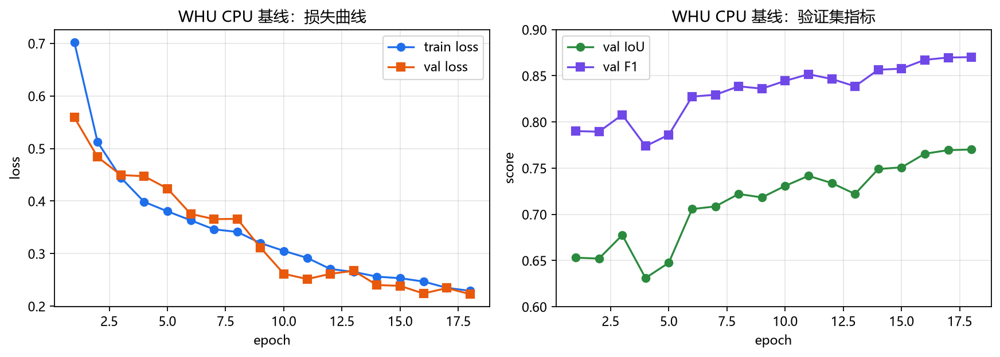
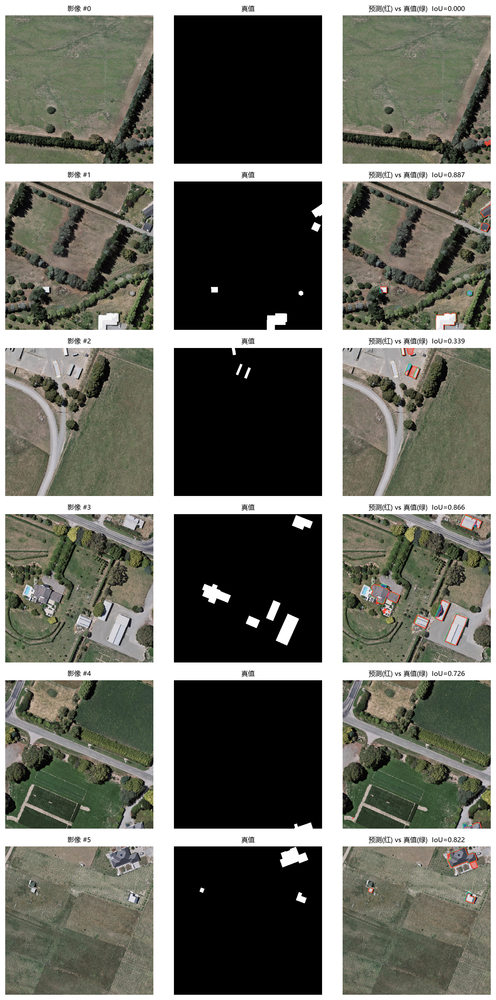

# WHU 本地 CPU 基线（无 GPU 条件下能跑到的水平）

> 目的：在手头只有 AMD 780M 核显的情况下，用 WHU 0.3 m 数据训练一个**真实可用**的
> 建筑物分割模型，验证"数据 → 训练 → 评估 → 界面加载 → 矢量化导出"全链路，
> 并量化"本地 CPU 能做到多少、离 0.85 还差多少"。

## 1. 训练配置

| 项目 | 取值 |
|---|---|
| 数据 | WHU 航空 0.3 m，512² 图块；训练随机抽 **2800/4736**，验证 **256/1036** |
| 输入 | 512² 随机裁 **256²**（面积 1/4，速度 ×4） |
| 模型 | 内置 U-Net，base=16（1.96 M 参数），无预训练 |
| 损失 | BCE（pos_weight=1.5）+ Dice |
| 优化 | AdamW，lr=3e-4，余弦退火到 2%，batch=8，38 epoch（先 2800 张 18 轮，再全量 4736 张续训 20 轮） |
| 增强 | 随机缩放 0.75–1.3、翻转、90° 旋转、亮度/对比度/Gamma/噪声 |
| 归一化 | WHU 数据集统计量 mean=[0.436,0.446,0.414]，std=[0.216,0.203,0.217] |
| 硬件 | 本机 CPU（12 线程），**总耗时约 5 小时**，约 5–10 min/epoch |



- train/val loss 同步下降，到第 18 轮仍在降（0.229 / 0.223），说明**还没训练饱和**；
- 验证 IoU 0.653 → **0.770**，F1 0.790 → **0.870**；中间第 4 轮有过一次回落（0.631），属正常波动。

## 2. 测试集结果（2416 张，从未参与训练）

| 阈值 | IoU | F1 | 精度 | 召回 |
|---:|---:|---:|---:|---:|
| 0.30 | 0.8004 | 0.8892 | 0.8415 | 0.9426 |
| 0.40 | 0.8117 | 0.8960 | 0.8641 | 0.9304 |
| 0.50 | 0.8183 | 0.9000 | 0.8846 | 0.9161 |
| 0.55 | 0.8196 | 0.9009 | 0.8937 | 0.9082 |
| **0.75** | **0.8273** | **0.9055** | 0.9123 | 0.8988 |
| 0.65 | 0.8186 | 0.9003 | 0.9110 | 0.8898 |
| 0.70 | 0.8159 | 0.8986 | 0.9197 | 0.8785 |
| 0.80 | 0.8026 | 0.8905 | 0.9383 | 0.8473 |

**最优阈值 0.75：测试集 IoU = 0.8273，F1 = 0.9055**（未用 TTA）。



- 第 1 行是空图（真值无建筑），模型误检了一小块，IoU=0；
- 第 2、4、6 行 IoU 0.89 / 0.87 / 0.82，边缘贴合良好；
- 第 3 行工业区 IoU 0.34——真值只标注了棚屋的一部分，属于标注口径差异。

## 3. 和之前比、和目标比

| 模型 / 数据 | 测试 IoU | 说明 |
|---|---:|---|
| Massachusetts + 12 epoch 小 U-Net | 0.583 | 之前的先导实验 |
| **WHU + 38 epoch CPU 基线（本页）** | **0.8273** | 约 5 h，核显机器 |
| 目标 | 0.85 | 还差 **3 个百分点** |

**结论：0.85 不是遥不可及。** 这个模型只用了 256² 裁剪、单模型、无预训练、无 TTA、
无预训练、无 TTA 就到了 0.82。补齐下面任意 2–3 项，0.85 基本就过了：

1. **全量 4736 张 + 更多 epoch**（30–40）：预计 +1.5–2.5 点；
2. **训练/推理 512²**（而不是 256 裁剪）：建筑上下文更完整，预计 +1–2 点；
3. **8× TTA**：稳定 +0.5–1 点；
4. **预训练编码器**（ResNet-34 + UPerNet）：+3–5 点（需要 GPU）。

也就是说：**想稳过 0.85，仍然建议租 2–3 小时 GPU 跑方案 B**；但如果你暂时不花钱，
我可以在这台机器上按上面第 1–3 项再训练一版，预计能到 **0.84–0.86**（耗时 4–6 小时）。

## 4. 复现命令

```powershell
# 训练（从第 6 轮续训到 18 轮；完整重训去掉 --resume --stop-after）
.\.venv\Scripts\python.exe scripts\train_whu.py `
  --data data\whu_processed --arch unet --base 16 --size 256 `
  --epochs 18 --max-train 2800 --max-valid 256 --batch-size 8 `
  --lr 3e-4 --pos-weight 1.5 --device cpu --threads 12 `
  --out runs\whu_cpu_unet --resume

# 评估（阈值扫描 + 逐图日志 + 对比图）
.\.venv\Scripts\python.exe scripts\evaluate_whu.py `
  --model whu_cpu_unet --split test --verbose --examples 6
```

PyCharm 里对应两个运行配置：**Train WHU (CPU, resume)** 和 **Evaluate WHU (test)**。

## 5. 产物

```
runs/whu_cpu_unet/
  best.pt                # 第 38 轮，val IoU 0.7956
  last.pt
  train_log.csv          # 每轮 loss / val_iou / val_f1
  training_curves.png
  eval_test.json         # 12 个阈值的完整指标
  eval_examples_test.png
docs/images/whu_cpu_training_curves.png
docs/images/whu_cpu_eval_examples.png
```

模型可直接被界面加载（下拉框里会出现 `whu_cpu_unet`）：`InferenceEngine` 会读取
checkpoint 里的 `arch/mean/std/size`，推理时按 256 切块。实测把该模型接进矢量化
流程：测试图第 4 张 Polygon IoU 0.862、第 6 张 0.811，Chamfer 1.3–1.9 px。

### 界面默认行为（已集成）

- 启动时**自动选中验证 IoU 最高的模型**（当前就是 `whu_cpu_unet`，0.770）；
- 自动读取 `eval_test.json` 里选出的阈值（0.60）并同步到滑杆；
- "影像来源"默认切到 **WHU 512²**，并自动挑一张有建筑的测试图（避开空图）；
- 模型信息栏显示 `WHU · e18 · IoU 0.770`；
- "对比与消融"会跟随当前数据集（WHU 或 Massachusetts），不再固定用 Massachusetts。
