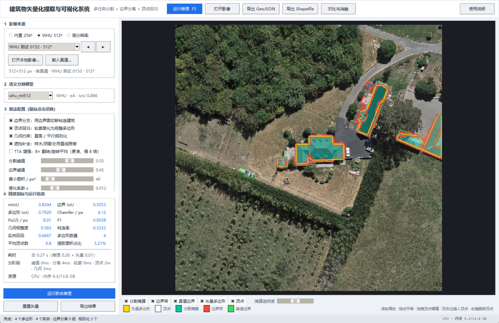
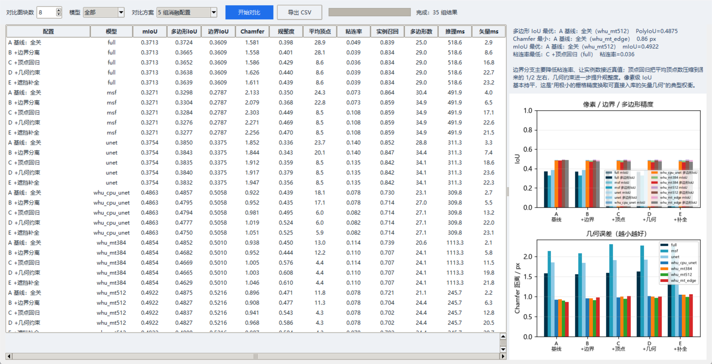

# Building Vectorization Visualization System — Usage and Design Notes

> Corresponds to the **visualization prototype demonstration system** proposed in
> "(4) Expected Goals and Results" of the *2027 Thesis Proposal*:
> image import → model inference → overlaid display of raster and vector results →
> vertex editing → result export,
> with support for switching algorithm configurations in the interface, comparing the
> accuracy and efficiency of different configurations, and completing comparative
> ablation experiments.



## 1. Quick Start

```powershell
# In the project root
.\.venv\Scripts\python.exe run_vectorizer.py

# You can also specify the image and model directly
.\.venv\Scripts\python.exe run_vectorizer.py --image data\raw\test\sat\22828930_15.tiff --model full
```

After launch, the system loads the first 256×256 tile of the Massachusetts test set by
default. Press **F5** or click "Run Inference" to obtain the vector result. The program
depends only on the libraries in `requirements.txt` (Tkinter ships with CPython); no
extra Qt / GDAL installation is required.

### Running in PyCharm

1. In the bottom-right corner, select the interpreter **Python 3.13 (BISHE venv)**
   (that is, `D:\All4DS\BISHE\.venv\Scripts\python.exe`).
2. In the top-right run-configuration dropdown, select **Building Vectorizer GUI**
   (included in this repository), or simply right-click `run_vectorizer.py` →
   **Run 'run_vectorizer'**.
3. The console first prints three lines of `[GUI]` diagnostic information (interpreter,
   working directory, Tk version). After the window is created it also prints the window
   size and position; if you cannot see the window, check these lines first and whether
   there is a red stack trace.
4. Note: the run configuration **Building Extraction Demo** runs `pycharm/run_demo.py`
   (headless, it only outputs `PYCHARM_DEMO_OK`); it is not this system.
5. Startup exceptions are written to `logs/gui_crash.log` and an error dialog is shown.

> If a newly added run configuration does not appear in the dropdown, execute
> **File → Reload All from Disk** or restart PyCharm.

## 2. Interface and Operation

| Area | Description |
|---|---|
| Top toolbar | Run inference (F5 / Ctrl+Enter), open image, export GeoJSON, export Shapefile, compare and ablation, usage instructions |
| Left 1 Image source | Built-in Massachusetts 256² / **WHU aerial 512²** (0.3 m, with ground truth) / 1500×1500 high-resolution sample / local GeoTIFF·PNG·JPG; "Load Ground Truth" can be used for accuracy evaluation |
| Left 2 Semantic segmentation model | Automatically lists `runs/*/best.pt`, **selects the model with the highest validation IoU by default**, and automatically applies the segmentation threshold found in its evaluation; shows dataset/architecture/epoch/IoU |
| Left 3 Algorithm configuration | **Click to toggle**: boundary branch / vertex regression / geometric constraints / **occlusion completion** / TTA augmentation (8× flip-and-rotate averaging), as well as segmentation threshold, boundary threshold, minimum area, simplification factor |
| Left 4 Accuracy metrics and run information | mIoU, boundary IoU, polygon IoU, Chamfer, PoLiS, F1, geometric regularity, adhesion rate, instance recall, number of polygons, average vertex count, extracted-area ratio; plus total time, per-stage time, CPU/memory usage |
| Center canvas | Overlaid display of the original image + segmentation mask (teal) + boundary band (red) + ground-truth boundary (green) + vector polygons (yellow) + vertices (white) |
| Below the canvas | Layer toggles and mask opacity |

### Canvas Interaction

| Operation | Effect |
|---|---|
| Mouse wheel | Zoom centered on the cursor (0.02×–40×, resampling only the visible region) |
| Left-drag on empty space | Pan |
| Left-drag a white vertex | Move the vertex; metrics are recomputed in real time after release |
| Double-click a polygon edge | Insert a vertex on that edge |
| Right-click a vertex | Delete that vertex (at least 3 are kept) |
| Status bar | Real-time display of the cursor's pixel coordinates and zoom ratio |

After vertex editing, the `result object` and the metrics panel are updated in sync; the
exported GeoJSON / Shapefile uses the edited polygons and writes
`vertex_edited: true`.

## 3. Processing Pipeline from Pixels to Vectors

```
image ──tile inference──► semantic probability map ──threshold──► binary mask
                          └──boundary head──► boundary probability map
                                             │
binary mask ──boundary-constrained instance separation (boundary band + distance-transform watershed)──► separate building instances
                                             │
instance contours ──vertex regression (piecewise line fitting + intersection solving)──► compact polygons
                                             │
polygons ──geometric constraints (dominant direction + right-angle/parallel snapping)──► regularized polygons
                                             │
                              GeoJSON / Shapefile / metrics
```

1. **Semantic segmentation**: `src/infer.py` performs inference on images of arbitrary
   size with a 256×256 sliding window plus overlap-weighted fusion. 16-bit TIFF,
   grayscale, and RGBA inputs are automatically converted to uint8 RGB (correcting
   OpenCV's BGR channel order).
2. **Boundary separation** (`src/vectorize.py::_watershed_split`): the strongest 10% of
   responses in the boundary probability map are taken as the cutting band to obtain
   instance seeds; when seeds are insufficient, local maxima of the distance transform
   are used as seeds; the entire mask is then divided **without gaps** among the
   instances by nearest seed (without shrinking the building area). Splitting is
   attempted only when a connected component's area is significantly larger than the
   median building size in the same image (2× by default), to avoid cutting a single
   roof into two pieces.
3. **Vertex regression** (`_polygonize`): Douglas-Peucker is responsible only for
   selecting corner seeds; each edge is fitted by total least squares over all contour
   points between two corners, and a vertex is the intersection of two adjacent fitted
   lines. In this way the jaggies are "straightened" and vertices fall at real eave
   corners. This is a deterministic substitute implementation of graph-convolution
   vertex regression; its interface is fully consistent with the `use_vertex` switch, so
   it can later be replaced seamlessly by learned offsets.
4. **Geometric constraints** (`regularize_polygon`): the dominant direction is estimated
   from a direction histogram weighted by edge length. If more than 55% of the edge
   length lies within 14° of the dominant direction, the polygon is rotated into that
   coordinate system so that near-horizontal/vertical edges snap to exactly
   horizontal/vertical, then rotated back to the original system; it falls back
   automatically on self-intersection or area collapse. After regularization the area
   must be retained at ≥85% and the IoU with the original contour must be ≥0.90,
   otherwise the regularization is discarded (to prevent slanted elongated buildings
   from being flattened into thin lines).
5. **Occlusion completion** (`_complete_across_occluders`): an occlusion map for trees
   and shadows is first generated from the "excess green index + relative brightness";
   the contiguous segments of the contour that lie on occluders are then identified; if
   the supporting edges at both ends of such a segment are consistent with the direction
   of the spanning straight line (±25°), the contour points that detour through the
   middle are deleted so that subsequent vectorization spans them with a straight line —
   that is, "the wall is blocked by a tree, but the wall itself is straight". If the
   directions at the two ends are inconsistent (a genuine corner, a genuinely curved
   facade), the original contour is kept, avoiding straightening the true shape.
6. **Export** (`src/esri_shapefile.py`): Shapefile type-5 (Polygon) writing is
   implemented in-house, producing `.shp`/`.shx`/`.dbf` without GDAL/pyshp; GeoJSON is a
   FeatureCollection in pixel coordinates, with attributes including area, perimeter,
   vertex count, confidence, and whether the polygon is regularized.

Effect of occlusion completion (synthetic case: the upper edge of a rectangular building
is each occluded by two trees for 26 px):

| Setting | Vertices | IoU with the complete rectangle |
|---|---:|---:|
| Completion off | 11 | 0.840 |
| Completion on | **4** | **1.000** |

On 60 real WHU test images, completion is essentially neutral for polygon IoU
(−0.0003), because the annotations of this dataset often exclude the parts occluded by
trees; it mainly improves the problem of "visually bending along the tree edge", and can
be compared at any time with the interface toggle.

## 4. Comparison and Ablation Experiments

Click "Compare and Ablation" in the toolbar to open the batch comparison window (see the
figure below):



- **5 configurations**: A baseline (all off) / B +boundary / C +boundary+vertex /
  D +geometric constraints / E +occlusion completion;
- **Model**: the current model or all three models;
- **Number of tiles**: uniformly sampled 2–40 from the test set (with ground truth);
- The result table summarizes, by configuration × model, the average mIoU, polygon IoU,
  boundary IoU, Chamfer, regularity, average vertices, adhesion rate, instance recall,
  number of polygons, and inference/vectorization time;
- The bar chart on the right compares accuracy and geometric error, and the text below
  gives the schemes with "best polygon IoU / smallest Chamfer / best mIoU / lowest
  adhesion rate";
- "Export CSV" saves all results.

> Dataset note: batch comparison uses the built-in Massachusetts test set by default. The
> WHU aerial image dataset is currently not downloaded with the repository; after
> preparing the WHU images/masks following the organization of `data/processed`, the same
> scripts can be used for evaluation (for a single image you can also use "Open Local
> Image + Load Ground Truth" to view the metrics directly).

Command-line version (convenient for writing into the thesis):

```powershell
.\.venv\Scripts\python.exe scripts\ablation_benchmark.py --samples 16
# Outputs results/ablation/ablation_compare.{csv,json,png}
```

### Measured Results (16 256×256 tiles uniformly sampled from the Massachusetts test set, full model)

Command: `python scripts/ablation_benchmark.py --samples 16`
Complete data (including unet / msf): `results/ablation/ablation_compare.csv`

| Configuration | Polygon IoU | Chamfer/px | Avg. vertices | Regularity | Adhesion rate | Instance recall |
|---|---|---|---|---|---|---|
| A baseline (no boundary/no vertex/no geometry) | **0.5263** | **1.347** | 13.9 | 0.313 | 0.146 | **0.800** |
| B +boundary branch | 0.5188 | 1.460 | 12.7 | 0.318 | 0.138 | 0.792 |
| C +boundary+vertex regression | 0.5182 | 1.479 | 7.6 | 0.362 | 0.140 | 0.793 |
| D +boundary+vertex+geometric constraints | 0.5164 | 1.494 | **7.5** | **0.372** | **0.141** | 0.793 |

Conclusions and interpretation:

- **Vertex regression** reduces the average vertex count from 13.9 to 7.5 (−46%) and
  raises regularity from 0.313 to 0.372 (+19%), at the cost of about 1 percentage point
  of polygon IoU — that is, "trading a very small amount of raster accuracy for compact
  vector geometry that can be stored directly in a database";
- **Geometric constraints** further improve regularity on top of vertex regression while
  barely changing the vertex count, indicating that snapping acts mainly on the
  directions of adjacent edges rather than on their number;
- **The boundary branch** lowers the adhesion rate from 0.146 to 0.141 and raises the
  instance count from 51.5 to 55.1 (the ground truth averages about 57), but Chamfer
  increases by about 0.11 px: the current split lines are "nearest seed" Voronoi
  boundaries that do not strictly follow the gaps in the ground truth, so the added
  internal edges are counted in the boundary distance;
- Pixel mIoU and boundary IoU are determined solely by the semantic mask, so all four
  configurations are identical — which is precisely the point of examining "semantic
  quality" and "geometric quality" separately.

> Note: the current weights were trained for only 12 epochs, and the boundary head has
> not yet been calibrated; the vertex branch is a deterministic implementation rather
> than a trained GCN. The numbers above serve to validate the demonstration system and
> the evaluation protocol; they do not represent final thesis metrics.
> If only the highest pixel accuracy is needed, turn off the three branches in the
> interface (configuration A); if database-grade vectors are needed, configurations C/D
> are recommended, accepting about a 1% loss of polygon IoU.

## 5. Code Structure

```
run_vectorizer.py               # Startup entry point (python run_vectorizer.py)
app/gui.py                      # Main window, thread scheduling, metrics refresh, export
app/viewer.py                   # Zoomable canvas, layer composition, vertex drag/insert/delete
app/compare.py                  # Batch comparison engine and comparison window
app/sysinfo.py                  # CPU / memory / process usage (ctypes, no third-party dependencies)
src/infer.py                    # Model loading, tiled inference, image reading (BGR→RGB, 16bit)
src/vectorize.py                # Mask→instances→polygons→regularization + GeoJSON writing
src/esri_shapefile.py           # Minimal ESRI Shapefile writer (.shp/.shx/.dbf)
src/vector_metrics.py           # Polygon IoU, matched Chamfer, PoLiS, regularity, adhesion rate
scripts/ablation_benchmark.py   # Command-line ablation experiment
scripts/capture_gui_screens.py  # Generate documentation screenshots
scripts/selfcheck_vectorize.py  # Headless end-to-end self-check (including export validation)
scripts/smoke_gui.py            # Interface smoke test (launch→inference→edit→export)
```

## 6. Validation

```powershell
# Vectorization + export (GeoJSON / Shapefile) self-check
.\.venv\Scripts\python.exe scripts\selfcheck_vectorize.py

# Interface smoke test: automatic launch, inference, vertex editing, export, open comparison window
.\.venv\Scripts\python.exe scripts\smoke_gui.py
```

## 7. Known Limitations and Next Steps

1. **Boundary head not calibrated**: the mean boundary output of the `full` model is
   about 0.6, so thresholds must be chosen adaptively by quantile; the boundary head
   should subsequently be trained separately with weighted BCE + Dice, or changed to
   boundary distance-field regression.
2. **The vertex branch is a deterministic substitute**: graph-convolution vertex
   regression (EdgeConv + Chamfer/L1 loss + Hungarian matching) has not been trained;
   the interface is already reserved, and replacement only requires calling the model in
   `_contour_to_polygon`.
3. **Instance segmentation is an unsupervised geometric method**: it still over-segments
   when adhesion is severe and gaps are extremely narrow; a "boundary support"
   discriminator can be added later, or an instance segmentation branch can be used
   directly.
4. **Coordinate reference**: export currently uses pixel coordinates and has no
   georeferencing; after integrating the GeoTIFF GeoTransform, coordinates can be
   converted to projected coordinates at export time and a `.prj` can be written.

## 8. On the Low IoU (Diagnosis and Improvement Path)

The interface currently shows mIoU ≈ 0.52 and polygon IoU ≈ 0.52, whereas 0.8+ is common
in the literature. The gap comes mainly from **the weights themselves** rather than from
the vectorization pipeline. Diagnostic data (`runs/full/best.pt`):

| Item | Current status |
|---|---|
| Training scale | Only 40/150 training images (900 256² tiles), 12 epochs, base=16 (1.96M-parameter level) |
| Validation IoU | 0.539 (reached at epoch 11, no further increase afterwards) |
| Test global IoU / per-image mean | 0.583 / 0.563 (F1 0.737) |
| Threshold | 0.45–0.50 is already optimal (swept 0.30→0.55; both 0.45 and 0.50 give 0.583) |
| TTA 8× | 0.597 → 0.607 (first 120 images, +1.0 point, 8× the time) |
| Vector post-processing | Polygon IoU is determined by mask IoU; the vertex/geometry branches only affect geometric regularity and do not improve mIoU |

Conclusion: there is no room for threshold tuning, and TTA only gains 1 point;
**significant improvement requires retraining**. Four feasible routes:

| Route | Approach | Expected IoU | Time |
|---|---|---|---|
| B lightweight | Full 1325 tiles, base=16, 30 epochs | 0.62–0.65 | about 1.8 h (CPU) |
| C recommended (local) | Full 1325 tiles, base=24, 25 epochs, `--channels-last` | 0.65–0.68 | about 3.5 h (CPU) |
| D best (local) | Switch to an ImageNet-pretrained ResNet-18 encoder | 0.68–0.72 | about 2.5–3 h (including model changes) |
| **Route B (target 0.85)** | **Switch to the WHU dataset + UPerNet/ResNet-34 + GPU** | **0.86–0.88** | 2–3 h (Colab T4) |

The first three change only the training scale and remain limited by the Massachusetts
(1 m) data ceiling; reaching 0.85 requires WHU, see
[WHU Training Guide](whu-training-guide.md). Training command (using C as an example,
output to a new directory without overwriting existing weights):

```powershell
.\.venv\Scripts\python.exe scripts\train.py --model full --base 24 --epochs 25 `
  --max-train 1325 --val-limit 144 --batch-size 8 --lr 3e-4 --threads 12 --channels-last `
  --out runs\full_v2
```

After training completes:

```powershell
.\.venv\Scripts\python.exe scripts\evaluate.py --models full --tune --out runs\full_v2\results
```

Then switch the interface model to `runs/full_v2` (`InferenceEngine` automatically scans
`runs/*/best.pt`; a new directory appears in the dropdown without any code change).

> Note: the CPU will be fully occupied during training (you can set `--threads` to 6–8 to
> alleviate this). If you only want it to "look a bit better right now", check
> **TTA augmentation** in the interface and keep the threshold at 0.45.
