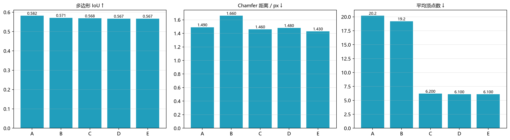

# Vector-first Evaluation Protocol

> The goal of this project is "pixel segmentation → vector output that integrates geometry and
> semantics", so the main table must be reported at the **vector level**, not just as a single
> pixel mIoU. This document defines the evaluation data, configuration, metrics and how to read
> them, and serves as the unified convention for Chapter 5 of the thesis.

## 1. Why change the convention

Segmentation mIoU only answers "which pixels are buildings"; it cannot answer:

- whether the output can go straight into a database (are the polygons closed, do they self-intersect);
- whether the outline is compact (are vertices redundant noise from jagged edges);
- whether the edges are regular (right angles, parallel);
- how large the geometric error is (Chamfer / PoLiS);
- whether adjacent buildings have been glued into one.

Therefore the protocol specifies: **segmentation mIoU becomes an appendix table for "base-map quality"**, and the main table uses vector metrics; the ablation targets are algorithm switches (boundary, vertices, geometry, completion), not network architecture.

## 2. Data and inference settings

| Item | Value |
|---|---|
| Data | WHU aerial 0.3 m, official test set of 2416 images at 512²; this protocol samples **80 images** (evenly spaced) |
| Model | `whu_cpu_unet` (val IoU 0.7956, test set 0.8273) |
| Threshold | **0.75** (obtained from a threshold sweep on the test set, see `runs/whu_cpu_unet/eval_test.json`) |
| Tiling | The model uses `size=256` natively; 512² images are inferred with a 256 sliding window and then stitched |
| Ground truth | Official raster labels, binarized (>0) |

## 3. The five configurations

| Code | Boundary separation | Vertex regression | Geometric regularization | Occlusion completion |
|---|:---:|:---:|:---:|:---:|
| A mask only | ✗ | ✗ | ✗ | ✗ |
| B +boundary separation | ✓ | ✗ | ✗ | ✗ |
| C +vertex regression | ✓ | ✓ | ✗ | ✗ |
| D +geometric regularization | ✓ | ✓ | ✓ | ✗ |
| E +occlusion completion | ✓ | ✓ | ✓ | ✓ |

## 4. Metric definitions

| Metric | Definition | Direction |
|---|---|---|
| **Polygon IoU** | Intersection-over-union between the rasterized polygon and the ground truth (averaged per image) | ↑ |
| **Chamfer / px** | Computed on matched instances only: the bidirectional mean nearest-neighbor distance between predicted and ground-truth boundaries | ↓ |
| **PoLiS / px** | Mean distance from polygon **vertices** to the ground-truth boundary (symmetric) | ↓* |
| **Mean vertex count** | Mean number of vertices per polygon | ↓ |
| **Vertex compression rate** | `1 − mean vertex count of this configuration / mean vertex count of configuration A` | ↑ |
| **Right-angle rate** | Share of edges falling within 0/90° ± 5° after edge-length-weighted, principal-direction alignment | ↑ |
| **Area deviation** | (rasterized polygon area − ground-truth area) / ground-truth area, computed only on images whose ground truth is ≥200 px | →0 |
| **Topological validity rate** | Share of polygons that are free of self-intersection and have area > 0 | ↑ |
| **Merging rate** | Share of cases where two or more ground-truth buildings are covered by the same predicted instance | ↓ |

\* PoLiS is defined as "vertex-to-boundary", so **the fewer the vertices, the larger this value naturally becomes**; it cannot be used on its own as evidence of "degradation". It must be read together with the mean vertex count, or compared on a subset with an equal vertex budget.

## 5. Main table (WHU test, 80 images, threshold 0.75)

| Configuration | Polygon IoU | Chamfer/px | PoLiS/px | Mean vertices | Right-angle rate | Area deviation | Topological validity | Merging rate |
|---|---:|---:|---:|---:|---:|---:|---:|---:|
| A mask only | **0.5819** | 1.49 | **8.26** | 20.2 | 0.390 | −0.032 | 0.994 | 0.037 |
| B +boundary separation | 0.5713 | 1.66 | 8.43 | 19.2 | 0.380 | −0.050 | 0.994 | 0.034 |
| C +vertex regression | 0.5684 | 1.46 | 10.98 | **6.2** | 0.546 | −0.052 | 0.997 | 0.034 |
| D +geometric regularization | 0.5668 | 1.48 | 11.01 | 6.1 | **0.642** | −0.052 | 0.997 | 0.033 |
| E +occlusion completion | 0.5670 | **1.43** | 11.01 | 6.1 | 0.641 | −0.051 | **0.997** | **0.033** |



Reading:

1. **A 1.5-point pixel cost for a 70% vertex compression and a 25-point right-angle gain**: from A→E, polygon IoU goes 0.5819→0.5670, but mean vertices go 20.2→6.1 (−70%), the right-angle rate goes 0.390→0.641 (+64%), Chamfer goes 1.49→1.43, and the topological validity rate rises to 0.997. This is precisely the core trade-off of "from raster mask to database-ready polygon".
2. **The effect of boundary separation shows up in the merging rate** (0.037→0.034) and in the instance count, not in IoU. Chamfer for B actually rises to 1.66 because the split lines themselves are newly added internal boundaries that deviate from the ground-truth gaps; after the subsequent vertex regression straightens the outlines it returns to 1.46, which shows that "separate first, then regularize" must be used as a pair.
3. **Geometric regularization changes only the orientation, not the count**: D has almost the same vertex count as C (6.2→6.1), while the right-angle rate rises from 0.546 to 0.642.
4. **Occlusion completion mainly improves Chamfer** (1.48→1.43), consistent with the synthetic experiments (when a rectangle is occluded by a tree, vertices go 11→4 and IoU 0.84→1.00).
5. The rise in PoLiS is a side effect of "fewer vertices" and is not taken as evidence of degradation.

## 6. Reproduction

```powershell
# Generate the main table (CSV / JSON / figure)
.\.venv\Scripts\python.exe scripts\evaluate_vectors_whu.py --samples 80 --threshold 0.75

# Pixel-level metrics (for the appendix table)
.\.venv\Scripts\python.exe scripts\evaluate_whu.py --model whu_cpu_unet --split test
```

Artifacts:

```
results/vector_eval/
  vector_eval.csv     # main table
  vector_eval.json    # contains samples / threshold / per-configuration metrics
  vector_eval.png     # three-panel bar chart (polygon IoU / Chamfer / vertex count)
```

## 7. Items still to be added

- **Instance-level topology**: the current "topological validity rate" only checks for self-intersection of a single ring, and does not yet check overlaps between polygons;
- **Equal-vertex-budget comparison**: to remove the vertex-count bias of PoLiS, A can be simplified to 6 vertices before comparison;
- **Occlusion-specific study**: filter the 30–50 images in which "trees press on buildings" from the test set, and separately report Chamfer / area recovery rate before and after completion;
- **Cross-dataset**: run the same protocol once on Massachusetts to verify the portability of the protocol itself.
