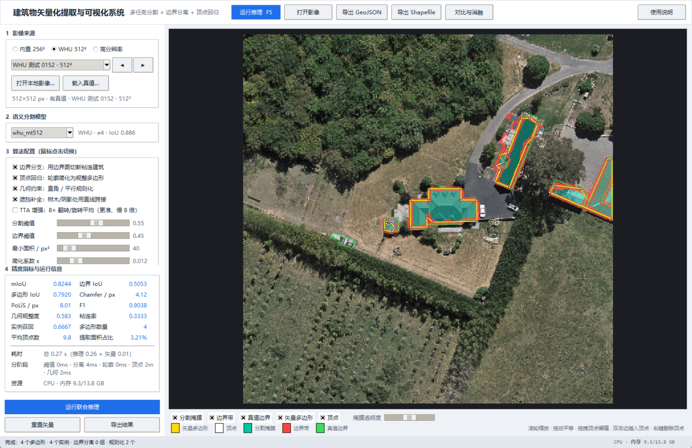
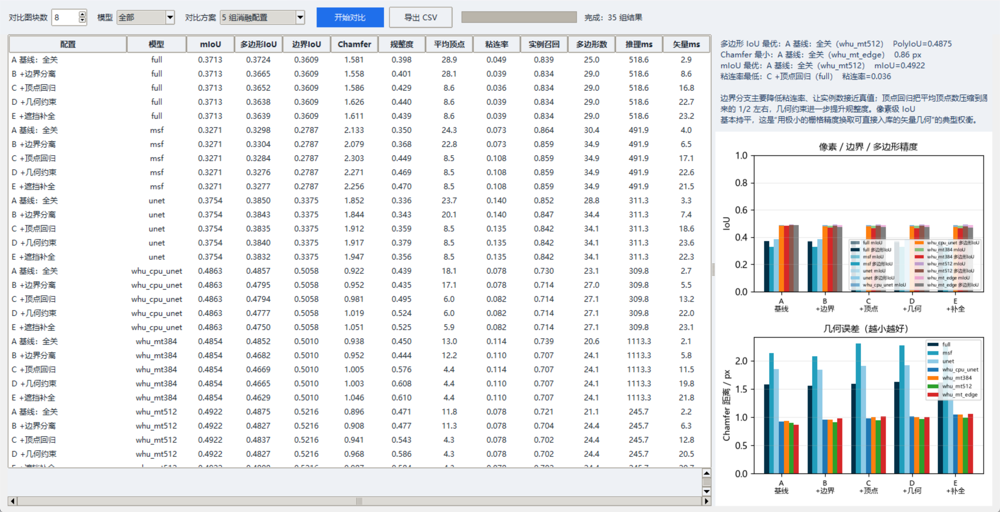

# 建筑物矢量化提取可视化系统 — 使用与设计说明

> 对应《2027 届开题报告》"（4）预期目标与结果"中提出的**可视化原型演示系统**：
> 影像导入 → 模型推理 → 栅格与矢量结果叠加显示 → 顶点编辑 → 结果导出，
> 并支持在界面上切换算法配置、比较不同配置的精度与效率、完成对比消融实验。



## 1. 快速开始

```powershell
# 在项目根目录
.\.venv\Scripts\python.exe run_vectorizer.py

# 也可以直接指定影像与模型
.\.venv\Scripts\python.exe run_vectorizer.py --image data\raw\test\sat\22828930_15.tiff --model full
```

启动后默认载入 Massachusetts 测试集的第 1 张 256×256 图块，按 **F5** 或点击
"运行推理"即可得到矢量结果。程序只依赖 `requirements.txt` 中的库（Tkinter 随
CPython 提供），不需要额外安装 Qt / GDAL。

### 在 PyCharm 中运行

1. 右下角解释器选择 **Python 3.13 (BISHE venv)**（即 `D:\All4DS\BISHE\.venv\Scripts\python.exe`）。
2. 右上角运行配置下拉框选择 **Building Vectorizer GUI**（本仓库已附带），或直接
   右键 `run_vectorizer.py` → **Run 'run_vectorizer'**。
3. 控制台会先打印三行 `[GUI]` 诊断信息（解释器、工作目录、Tk 版本），窗口创建后
   还会打印窗口尺寸与位置；若看不到窗口，先看这几行和是否有红色堆栈。
4. 注意：运行配置里的 **Building Extraction Demo** 跑的是 `pycharm/run_demo.py`
   （无界面，只输出 `PYCHARM_DEMO_OK`），不是本系统。
5. 启动异常会写入 `logs/gui_crash.log`，同时弹出错误对话框。

> 新加的运行配置如果没出现在下拉框里，执行 **File → Reload All from Disk** 或重启
> PyCharm 即可。

## 2. 界面与操作

| 区域 | 说明 |
|---|---|
| 顶部工具栏 | 运行推理（F5 / Ctrl+Enter）、打开影像、导出 GeoJSON、导出 Shapefile、对比与消融、使用说明 |
| 左侧 1 影像来源 | 内置 Massachusetts 256² / **WHU 航空 512²**（0.3 m，带真值）/ 1500×1500 高分辨率样例 / 本地 GeoTIFF·PNG·JPG；可"载入真值"用于精度评价 |
| 左侧 2 语义分割模型 | 自动列出 `runs/*/best.pt`，**默认选验证 IoU 最高的模型**，并自动套用它评测出的分割阈值；显示数据集/架构/epoch/IoU |
| 左侧 3 算法配置 | **鼠标点击**切换：边界分支 / 顶点回归 / 几何约束 / **遮挡补全** / TTA 增强（8× 翻转旋转平均），以及分割阈值、边界阈值、最小面积、简化系数 |
| 左侧 4 精度指标与运行信息 | mIoU、边界 IoU、多边形 IoU、Chamfer、PoLiS、F1、几何规整度、粘连率、实例召回、多边形数量、平均顶点数、提取面积占比；以及总耗时、分阶段耗时、CPU/内存占用 |
| 中间画布 | 原图 + 分割掩膜（青绿）+ 边界带（红）+ 真值边界（绿）+ 矢量多边形（黄）+ 顶点（白）叠加显示 |
| 画布下方 | 图层开关与掩膜透明度 |

### 画布交互

| 操作 | 效果 |
|---|---|
| 滚轮 | 以光标为中心缩放（0.02×–40×，只重采样可见区域） |
| 左键拖动空白处 | 平移 |
| 左键拖动白色顶点 | 移动顶点，松开后指标实时重算 |
| 双击多边形边 | 在该边插入顶点 |
| 右键点击顶点 | 删除该顶点（保留至少 3 个） |
| 状态栏 | 实时显示光标像素坐标与缩放比例 |

顶点编辑后，`结果对象` 与指标面板同步更新，导出的 GeoJSON / Shapefile 使用编辑后的
多边形，并写入 `vertex_edited: true`。

## 3. 从像素到矢量的处理流程

```
影像 ──tile 推理──► 语义概率图 ──阈值──► 二值掩膜
                         └──边界头──► 边界概率图
                                            │
二值掩膜 ──边界约束实例分离（边界带 + 距离变换分水岭）──► 独立建筑实例
                                            │
实例轮廓 ──顶点回归（分段直线拟合 + 交点求解）──► 紧凑多边形
                                            │
多边形 ──几何约束（主方向 + 直角/平行吸附）──► 规整多边形
                                            │
                              GeoJSON / Shapefile / 指标
```

1. **语义分割**：`src/infer.py` 以 256×256 滑窗 + 重叠加权融合推理任意尺寸影像，
   16 位 TIFF、灰度、RGBA 输入自动转 uint8 RGB（修正 OpenCV 的 BGR 通道顺序）。
2. **边界分离**（`src/vectorize.py::_watershed_split`）：取边界概率图最强 10% 响应
   作为切割带，得到实例种子；种子不足时用距离变换局部极大值作种子；再按最近种子
   把整块掩膜**无缝隙**划分给各实例（不缩小建筑面积）。仅当连通块面积显著大于
   同图建筑中位数（默认 2 倍）时才尝试分裂，避免把单个屋顶切成两块。
3. **顶点回归**（`_polygonize`）：Douglas-Peucker 只负责挑选角点种子，每条边由两
   角点之间的全部轮廓点做总体最小二乘拟合，顶点取相邻两条拟合直线的交点，因此
   锯齿被"拉直"，顶点落在真实屋檐转角处。这是图卷积顶点回归的确定性替代实现，
   接口与 `use_vertex` 开关完全一致，后续可无缝替换为学习到的偏移量。
4. **几何约束**（`regularize_polygon`）：由边长加权的方向直方图估计主方向，
   若 55% 以上边长在主方向 14° 内，则旋转到该坐标系把接近水平/竖直的边吸附为
   严格水平/竖直，再旋转回原坐标系；自交、面积塌缩时自动回退。规则化后还要求
   面积保留 ≥85%、与原轮廓 IoU ≥0.90，否则放弃（防止斜向长条建筑被压成细线）。
5. **遮挡补全**（`_complete_across_occluders`）：先用"过量绿指数 + 相对亮度"
   生成树木/阴影的遮挡图；统计轮廓上有哪些连续片段贴在遮挡物上；若该片段两端
   的支撑边与跨接直线方向一致（±25°），就删掉中间绕行的轮廓点，让后续矢量化
   用一条直线跨接——即"墙被树挡住，但墙本身是直的"。若两端方向不一致（真拐角、
   真弧形立面），则保留原轮廓，避免把真实形状拉直。
6. **导出**（`src/esri_shapefile.py`）：自行实现 Shapefile type-5（Polygon）写
   出，包含 `.shp`/`.shx`/`.dbf`，无需 GDAL/pyshp；GeoJSON 为像素坐标系
   FeatureCollection，属性含面积、周长、顶点数、置信度、是否规则化。

遮挡补全的效果（合成用例：矩形建筑上边缘被两棵树各遮住 26 px）：

| 设置 | 顶点数 | 与完整矩形的 IoU |
|---|---:|---:|
| 关闭补全 | 11 | 0.840 |
| 开启补全 | **4** | **1.000** |

真实 WHU 测试集 60 张上，补全对多边形 IoU 基本中性（−0.0003），因为该数据集的
标注本身常把被树遮挡的部分排除在外；它主要改善"视觉上贴着树边弯曲"的问题，且
可用界面开关随时对比。

## 4. 对比与消融实验

点击工具栏"对比与消融"打开批量比较窗口（见下图）：



- **5 组配置**：A 基线（全关）/ B +边界 / C +边界+顶点 / D +几何约束 / E +遮挡补全；
- **模型**：当前模型或全部三个模型；
- **图块数**：从测试集均匀抽样 2–40 张（带真值）；
- 结果表按配置×模型汇总平均 mIoU、多边形 IoU、边界 IoU、Chamfer、规整度、
  平均顶点、粘连率、实例召回、多边形数、推理/矢量化耗时；
- 右侧柱状图对比精度与几何误差，下方文字给出"多边形 IoU 最优 / Chamfer 最小 /
  mIoU 最优 / 粘连率最低"的方案；
- "导出 CSV"保存全部结果。

> 数据集说明：批量对比默认使用内置的 Massachusetts 测试集。WHU 航空影像数据集
> 目前未随仓库下载；把 WHU 的影像/掩膜按 `data/processed` 的组织方式准备后，可用
> 同一套脚本评测（单张影像也可用"打开本地影像 + 载入真值"直接看指标）。

命令行版本（便于写进论文）：

```powershell
.\.venv\Scripts\python.exe scripts\ablation_benchmark.py --samples 16
# 输出 results/ablation/ablation_compare.{csv,json,png}
```

### 实测结果（Massachusetts 测试集均匀抽样 16 张 256×256，full 模型）

命令：`python scripts/ablation_benchmark.py --samples 16`
完整数据（含 unet / msf）：`results/ablation/ablation_compare.csv`

| 配置 | 多边形IoU | Chamfer/px | 平均顶点 | 规整度 | 粘连率 | 实例召回 |
|---|---|---|---|---|---|---|
| A 基线（无边界/无顶点/无几何） | **0.5263** | **1.347** | 13.9 | 0.313 | 0.146 | **0.800** |
| B +边界分支 | 0.5188 | 1.460 | 12.7 | 0.318 | 0.138 | 0.792 |
| C +边界+顶点回归 | 0.5182 | 1.479 | 7.6 | 0.362 | 0.140 | 0.793 |
| D +边界+顶点+几何约束 | 0.5164 | 1.494 | **7.5** | **0.372** | **0.141** | 0.793 |

结论与解读：

- **顶点回归**把平均顶点数从 13.9 压到 7.5（−46%），规整度从 0.313 升到 0.372
  （+19%），代价是多边形 IoU 下降约 1 个百分点——即"用很小的栅格精度换取可直接
  入库的紧凑矢量几何"；
- **几何约束**在顶点回归基础上再提升规整度，且几乎不改变顶点数，说明吸附主要
  发生在相邻边的方向而非数量上；
- **边界分支**把粘连率从 0.146 降到 0.141、实例数从 51.5 提升到 55.1（真值平均
  约 57），但 Chamfer 上升约 0.11 px：当前分裂线是"最近种子"的 Voronoi 边界，
  并不严格贴合真值缝隙，新增的内部边会被计入边界距离；
- 像素 mIoU 与边界 IoU 只由语义掩膜决定，因此四组配置完全相同，这正是把"语义
  质量"与"几何质量"分开考察的意义。

> 说明：当前权重仅训练 12 个 epoch，边界头尚未标定；顶点分支是确定性实现而非
> 训练得到的 GCN。上述数字用于验证演示系统与评测协议，不代表最终论文指标。
> 若只需最高像素精度，界面中关闭三个分支（配置 A）即可；若需要入库级矢量，
> 建议配置 C/D 并接受约 1% 的多边形 IoU 折损。

## 5. 代码结构

```
run_vectorizer.py               # 启动入口（python run_vectorizer.py）
app/gui.py                      # 主窗口、线程调度、指标刷新、导出
app/viewer.py                   # 可缩放画布、图层合成、顶点拖拽/插入/删除
app/compare.py                  # 批量对比引擎与对比窗口
app/sysinfo.py                  # CPU / 内存 / 进程占用（ctypes，无第三方依赖）
src/infer.py                    # 模型加载、切片推理、影像读取（BGR→RGB、16bit）
src/vectorize.py                # 掩膜→实例→多边形→规则化 + GeoJSON 写出
src/esri_shapefile.py           # 最小 ESRI Shapefile 写出（.shp/.shx/.dbf）
src/vector_metrics.py           # 多边形 IoU、匹配 Chamfer、PoLiS、规整度、粘连率
scripts/ablation_benchmark.py   # 命令行消融实验
scripts/capture_gui_screens.py  # 生成文档截图
scripts/selfcheck_vectorize.py  # 无界面端到端自检（含导出校验）
scripts/smoke_gui.py            # 界面冒烟测试（启动→推理→编辑→导出）
```

## 6. 验证

```powershell
# 矢量化 + 导出（GeoJSON / Shapefile）自检
.\.venv\Scripts\python.exe scripts\selfcheck_vectorize.py

# 界面冒烟测试：自动启动、推理、编辑顶点、导出、打开对比窗口
.\.venv\Scripts\python.exe scripts\smoke_gui.py
```

## 7. 已知限制与下一步

1. **边界头未标定**：`full` 模型的边界输出均值约 0.6，需按分位数自适应取阈值；
   后续用加权 BCE + Dice 单独训练边界头，或改成边界距离场回归。
2. **顶点分支是确定性替代**：图卷积顶点回归（EdgeConv + Chamfer/L1 损失 + 匈牙利
   匹配）尚未训练，接口已预留，替换时只需在 `_contour_to_polygon` 中调用模型。
3. **实例分割为无监督几何方法**：粘连严重且缝隙极窄时仍会过分割，后续可加入
   "边界支持度"判别，或直接使用实例分割分支。
4. **坐标参考**：当前按像素坐标导出，尚无地理参考；接入 GeoTIFF 的 GeoTransform
   后可在导出时换算为投影坐标并写出 `.prj`。

## 8. 关于 IoU 偏低（诊断与提升路径）

当前界面显示 mIoU ≈ 0.52、多边形 IoU ≈ 0.52，而论文里常见 0.8+，差距主要来自
**权重本身**而不是矢量化流程。诊断数据（`runs/full/best.pt`）：

| 项目 | 现状 |
|---|---|
| 训练规模 | 仅 40/150 张训练图（900 个 256² 图块），12 epoch，base=16（1.96M 参数级别） |
| 验证集 IoU | 0.539（第 11 epoch 达到，之后不再上升） |
| 测试集全局 IoU / 逐图均值 | 0.583 / 0.563（F1 0.737） |
| 阈值 | 0.45–0.50 已是最优（0.30→0.55 扫描，0.45 与 0.50 均为 0.583） |
| TTA 8× | 0.597 → 0.607（前 120 张，+1.0 分，耗时 8 倍） |
| 矢量后处理 | 多边形 IoU 由掩膜 IoU 决定；顶点/几何分支只影响几何规整度，不提升 mIoU |

结论：调阈值没有空间，TTA 只能拿 1 分，**要显著提升必须重新训练**。四条可行路线：

| 路线 | 做法 | 预计 IoU | 时间 |
|---|---|---|---|
| B 轻量 | 全量 1325 图块、base=16、30 epoch | 0.62–0.65 | 约 1.8 h（CPU） |
| C 推荐（本地） | 全量 1325 图块、base=24、25 epoch、`--channels-last` | 0.65–0.68 | 约 3.5 h（CPU） |
| D 最佳（本地） | 换 ImageNet 预训练 ResNet-18 编码器 | 0.68–0.72 | 约 2.5–3 h（含改模型） |
| **B 方案（目标 0.85）** | **换 WHU 数据集 + UPerNet/ResNet-34 + GPU** | **0.86–0.88** | 2–3 h（Colab T4） |

前三条只改训练规模，仍受 Massachusetts（1 m）数据上限约束；要 0.85 必须走 WHU，
见 [WHU训练指南](WHU训练指南.md)。训练命令（以 C 为例，输出到新目录，不覆盖现有权重）：

```powershell
.\.venv\Scripts\python.exe scripts\train.py --model full --base 24 --epochs 25 `
  --max-train 1325 --val-limit 144 --batch-size 8 --lr 3e-4 --threads 12 --channels-last `
  --out runs\full_v2
```

训练完成后：

```powershell
.\.venv\Scripts\python.exe scripts\evaluate.py --models full --tune --out runs\full_v2\results
```

再把界面模型切到 `runs/full_v2`（`InferenceEngine` 会自动扫描 `runs/*/best.pt`，
新目录无需改代码即可出现在下拉框里）。

> 注意：训练时 CPU 会被占满（可把 `--threads` 调到 6–8 缓解）。若只想要"现在就能
> 好看一点"，勾选界面里的 **TTA 增强** 并保持阈值 0.45 即可。
