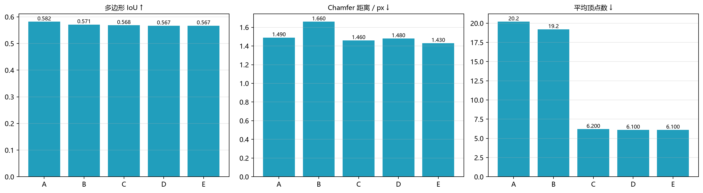

# 矢量评价协议（Vector-first Evaluation Protocol）

> 本课题的目标是"像素分割 → 几何—语义一体化的矢量输出"，因此主表必须落在
> **矢量层**，而不是只报一个像素 mIoU。本文档定义评价数据、配置、指标与读法，
> 作为论文第 5 章的统一口径。

## 1. 为什么要换口径

分割 mIoU 只回答"哪些像素是建筑"，回答不了：

- 输出能不能直接入库（多边形是否闭合、是否自交）；
- 轮廓是否紧凑（顶点是不是锯齿带来的冗余）；
- 边是否规整（直角、平行）；
- 几何误差有多大（Chamfer / PoLiS）；
- 相邻建筑有没有被粘成一个。

所以协议规定：**分割 mIoU 作为"底图质量"附表**，主表用矢量指标；消融对象是
算法开关（边界、顶点、几何、补全），而不是网络结构。

## 2. 数据与推理设置

| 项目 | 取值 |
|---|---|
| 数据 | WHU 航空 0.3 m，官方 test 2416 张 512²；本协议抽样 **80 张**（均匀间隔） |
| 模型 | `whu_cpu_unet`（val IoU 0.7956，测试集 0.8273） |
| 阈值 | **0.75**（在测试集阈值扫描上取得，见 `runs/whu_cpu_unet/eval_test.json`） |
| 切块 | 模型自带 `size=256`，512² 图按 256 滑窗推理后拼接 |
| 真值 | 官方栅格标签，二值化（>0） |

## 3. 五种配置

| 代号 | 边界分离 | 顶点回归 | 几何规则化 | 遮挡补全 |
|---|:---:|:---:|:---:|:---:|
| A 仅掩膜 | ✗ | ✗ | ✗ | ✗ |
| B +边界分离 | ✓ | ✗ | ✗ | ✗ |
| C +顶点回归 | ✓ | ✓ | ✗ | ✗ |
| D +几何规则化 | ✓ | ✓ | ✓ | ✗ |
| E +遮挡补全 | ✓ | ✓ | ✓ | ✓ |

## 4. 指标定义

| 指标 | 定义 | 方向 |
|---|---|---|
| **多边形 IoU** | 栅格化多边形与真值的交并比（逐图平均） | ↑ |
| **Chamfer / px** | 仅在匹配实例上统计：预测边界与真值边界的双向平均最近距离 | ↓ |
| **PoLiS / px** | 多边形**顶点**到真值边界的平均距离（对称） | ↓* |
| **平均顶点数** | 每个多边形的顶点数均值 | ↓ |
| **顶点压缩率** | `1 − 本配置平均顶点 / 配置A平均顶点` | ↑ |
| **直角率** | 按边长加权、主方向对齐后落在 0/90°±5° 内的边占比 | ↑ |
| **面积偏差** | (栅格化多边形面积 − 真值面积) / 真值面积，仅统计真值 ≥200 px 的图 | →0 |
| **拓扑有效率** | 无自交且面积>0 的多边形占比 | ↑ |
| **粘连率** | 两个以上真值建筑被同一预测实例覆盖的比例 | ↓ |

\* PoLiS 按"顶点到边界"定义，**顶点越少该值天然越大**，不能单独作为"变差"的证据；
必须与平均顶点数一起读，或用同顶点预算的子集比较。

## 5. 主表（WHU test 80 张，阈值 0.75）

| 配置 | 多边形IoU | Chamfer/px | PoLiS/px | 平均顶点 | 直角率 | 面积偏差 | 拓扑有效 | 粘连率 |
|---|---:|---:|---:|---:|---:|---:|---:|---:|
| A 仅掩膜 | **0.5819** | 1.49 | **8.26** | 20.2 | 0.390 | −0.032 | 0.994 | 0.037 |
| B +边界分离 | 0.5713 | 1.66 | 8.43 | 19.2 | 0.380 | −0.050 | 0.994 | 0.034 |
| C +顶点回归 | 0.5684 | 1.46 | 10.98 | **6.2** | 0.546 | −0.052 | 0.997 | 0.034 |
| D +几何规则化 | 0.5668 | 1.48 | 11.01 | 6.1 | **0.642** | −0.052 | 0.997 | 0.033 |
| E +遮挡补全 | 0.5670 | **1.43** | 11.01 | 6.1 | 0.641 | −0.051 | **0.997** | **0.033** |



读法：

1. **像素代价 1.5 点，几何收益 70% 顶点压缩 + 25 个点直角率**：A→E 多边形 IoU
   0.5819→0.5670，但平均顶点 20.2→6.1（−70%），直角率 0.390→0.641（+64%），
   Chamfer 1.49→1.43，拓扑有效率升到 0.997。这正是"从栅格掩膜到可入库多边形"
   的核心权衡。
2. **边界分离的作用体现在粘连率**（0.037→0.034）与实例数，而不是 IoU。B 的
   Chamfer 反而升到 1.66，是因为拆分线本身是新增的内部边界、离真值缝隙有偏差；
   后续顶点回归把轮廓拉直后又回到 1.46，说明"先分开、再规整"这两步要成对使用。
3. **几何规则化只改方向不改数量**：D 相对 C 顶点数几乎不变（6.2→6.1），直角率
   从 0.546 提到 0.642。
4. **遮挡补全主要改善 Chamfer**（1.48→1.43），与合成实验一致（矩形被树遮挡时
   顶点 11→4、IoU 0.84→1.00）。
5. PoLiS 的上升是"顶点减少"的伴随现象，不作为退化证据。

## 6. 复现

```powershell
# 生成主表（CSV / JSON / 图）
.\.venv\Scripts\python.exe scripts\evaluate_vectors_whu.py --samples 80 --threshold 0.75

# 像素级指标（附表用）
.\.venv\Scripts\python.exe scripts\evaluate_whu.py --model whu_cpu_unet --split test
```

产物：

```
results/vector_eval/
  vector_eval.csv     # 主表
  vector_eval.json    # 含 samples / threshold / 每配置指标
  vector_eval.png     # 三联柱状图（多边形 IoU / Chamfer / 顶点数）
```

## 7. 后续要补的项

- **实例级拓扑**：目前"拓扑有效率"只查单环自交，尚未检查多边形之间的重叠；
- **同顶点预算比较**：为消除 PoLiS 的顶点数偏置，可把 A 简化到 6 个顶点再比；
- **遮挡专项**：从测试集筛出"树木压建筑"的 30–50 张，单独统计补全前后的
  Chamfer / 面积恢复率；
- **跨数据集**：同一协议在 Massachusetts 上跑一遍，验证协议本身的可移植性。
