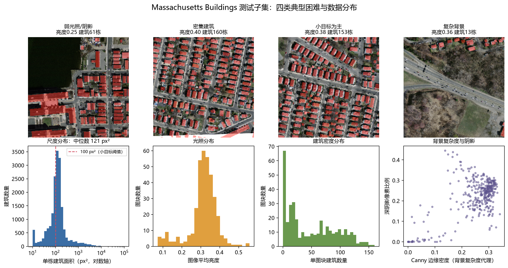
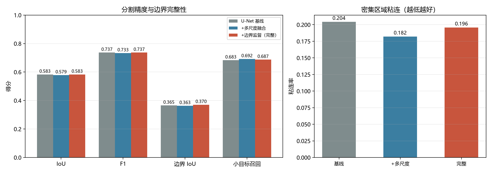
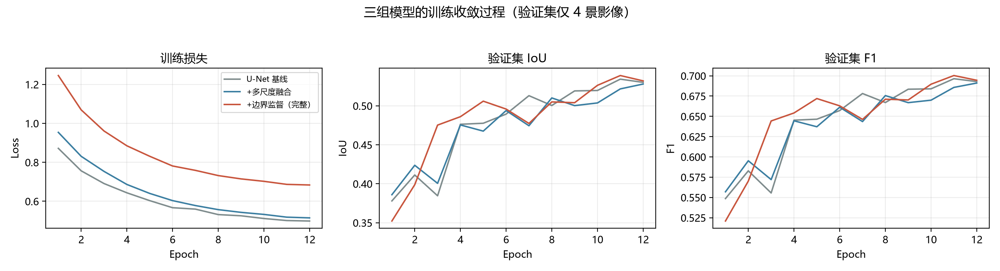
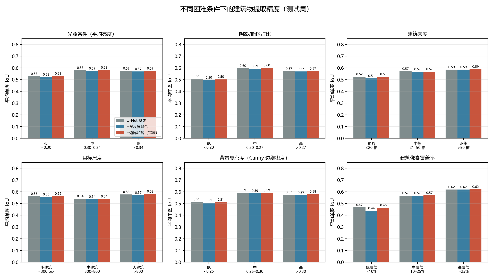
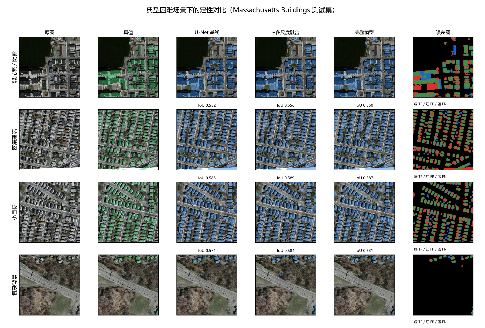
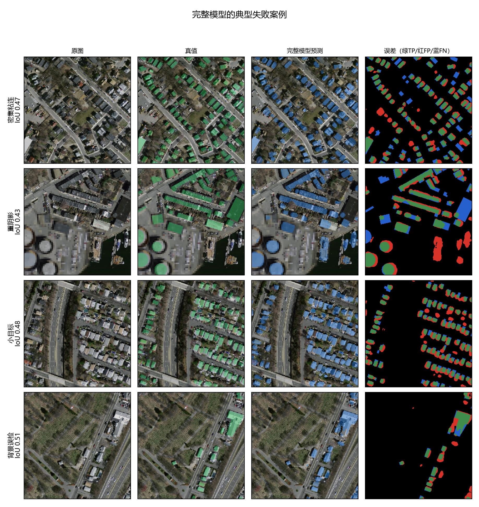

# 航拍图像建筑物自动提取初步研究报告

**课题方向**：基于深度学习的航拍图像建筑物自动提取  
**本阶段工作**：数据与问题量化、基线复现、多尺度/边界改进初探、失败案例分析  
**实验环境**：Python 3.13.5 + PyTorch 2.14.1（CPU），AMD Ryzen 7 8845H，14 GB 内存，无 CUDA  
**报告日期**：2026-10-19

---

## 摘要

航拍建筑物提取在城市规划、灾害评估、基础地理信息更新等任务中具有重要价值，但受光照变化、遮挡、尺度差异和复杂背景影响，模型容易出现边界模糊、小目标漏提和密集区域粘连。本阶段在公开的 Massachusetts Buildings Dataset 上搭建了一套可复现的 CPU 实验流程：将 40 张 1 m 分辨率航拍图切分为 1325 张训练图块，量化了目标尺度、光照、密度和背景复杂度；以 U-Net 为基线，分别引入 ASPP 多尺度上下文模块和边界辅助监督，完成三组对照实验。

测试集（360 张 256×256 图块、17 964 栋建筑）上，基线 U-Net 取得 IoU 0.5830、F1 0.7366、边界 IoU 0.3653、小目标召回 0.6830、粘连率 0.2042。引入 ASPP 后，小目标召回提升至 0.6919，粘连率降至 0.1821（相对下降 10.8%），但 IoU 降至 0.5785，说明多尺度上下文主要改善了“找得到、分得开”，同时带来了更多误检。进一步加入边界辅助监督后，边界 IoU 提升至 0.3703（相对提升 1.4%），平均单图 IoU 达到 0.5634，但总体 IoU 与基线基本持平（0.5830），且 95% Bootstrap 置信区间包含 0，尚未形成显著的精度增益。

本阶段的结论是：**在 1 m 分辨率、小样本、短训练预算下，单一结构改进不足以稳定提升总体 IoU；ASPP 与边界监督分别对“粘连”和“边界完整性”有效，但存在精度—召回—误检的权衡。** 下一阶段应转向更高分辨率数据、预训练编码器、边界感知损失与实例分离后处理，并在多区域数据上验证泛化性。

---

## 1. 问题拆解与研究目标

### 1.1 应用背景

航拍图像建筑物自动提取要求从 RGB 影像中逐像素判定建筑覆盖，输出二值掩膜，并尽可能保持建筑轮廓的几何完整性。其结果可直接用于：

- 城市规划与容积率估算；
- 灾害（地震、洪涝、火灾）损失快速评估；
- 违规建筑监测与土地执法；
- 基础测绘地图更新与三维建模。

### 1.2 四类核心困难

| 困难 | 在影像中的表现 | 对模型的影响 | 本阶段应对 |
|---|---|---|---|
| 光照变化 | 阴影、曝光不足、屋顶反光、昼夜差异 | 屋顶纹理丢失、边界对比度下降 | 亮度/对比度/Gamma 增强；按亮度分层评价 |
| 遮挡与复杂背景 | 树冠遮挡、道路、水体、码头、油罐、裸地 | 建筑与背景混淆，产生误检；遮挡处漏提 | ASPP 扩大上下文；失败案例分析 |
| 尺度差异 | 小屋顶仅几十像素，大厂房跨越百米 | 小目标漏提；大建筑内部空洞、边界不完整 | ASPP 多膨胀率分支；小目标召回指标 |
| 密集区域 | 联排住宅、厂房群屋顶紧邻 | 相邻建筑被预测为同一连通域（粘连） | ASPP；粘连率指标；后续实例分离 |

与上述困难对应的三个评价难点是：

1. **边界模糊**：像素 IoU 对边界不敏感，需要边界 IoU；
2. **小目标漏提**：整图 IoU 会被大面积建筑主导，需要小目标实例召回；
3. **密集粘连**：语义分割不区分实例，需要统计“多个真值建筑共享一个预测连通域”的比例。

### 1.3 本阶段目标

1. 在本机纯 CPU 环境下跑通“数据—训练—评价—可视化”闭环；
2. 用可量化指标证明四类困难确实存在，而不是仅凭主观描述；
3. 实现 U-Net 基线、ASPP 多尺度模型、ASPP + 边界监督模型三组对照；
4. 通过总体指标、分场景指标、边界指标、实例指标和失败案例，判断改进模块是否有效，并给出下一阶段技术路线。

---

## 2. 数据与难度量化

### 2.1 数据集与切块

采用 Mnih（2013）发布的 **Massachusetts Buildings Dataset**。原始影像为 1500×1500 的 RGB 航拍图，地面分辨率约 1 m，标签为建筑/非建筑二值图。该数据集覆盖美国马萨诸塞州的城市、郊区、工业区和海岸带，场景类型较丰富，适合作为初步研究的公开基准。

为控制 CPU 训练成本，本阶段使用官方训练集中的 40 张影像，保留官方验证集与测试集。按 256×256、步长 256 切块，训练集仅保留含建筑图块并加入少量空图块，验证/测试集保留全部图块。最终得到：

| 划分 | 原始影像 | 图块数 | 建筑像素占比 | 含建筑图块比例 |
|---|---:|---:|---:|---:|
| 训练 | 40 | 1325 | 13.60% | 99.85% |
| 验证 | 4 | 144 | 10.72% | 94.44% |
| 测试 | 10 | 360 | 18.68% | 93.06% |

> 说明：官方验证集只有 4 张影像，导致验证集只有 144 个图块，模型选择和阈值选择的不确定性较大；这是本阶段的一个明确限制。

### 2.2 四类困难的量化结果

对训练集和测试集的全部建筑连通域、图块亮度、暗区比例、Canny 边缘密度和建筑数量进行统计，结果如下（测试集）：

| 指标 | 数值 | 含义 |
|---|---:|---|
| 建筑总数 | 17 964 栋 | 测试集实例规模 |
| 单栋面积中位数 | 121 px² | 约 121 m²（1 m 分辨率） |
| 单栋面积 P10 / P90 | 39 / 289 px² | 长尾分布明显 |
| 面积 < 100 px² 的建筑 | 35.1% | 超过三分之一属于小目标 |
| 面积 < 300 px² 的建筑 | 90.3% | 绝大多数为中小尺度 |
| 单图块建筑数均值 | 49.9 栋 | 密集排列常见 |
| 建筑数 > 20 的图块 | 61.1% | 密集场景占比高 |
| 平均亮度 | 0.313 | 整体偏暗 |
| 亮度 P10 / P90 | 0.223 / 0.385 | 明暗差异显著 |
| 暗区像素比例均值 | 22.3% | 阴影/低曝光普遍 |
| Canny 边缘密度均值 | 0.252 | 道路、树木、岸线带来大量干扰边缘 |

训练集与测试集之间存在明显的**分布偏移**：训练集单栋面积中位数为 119 px²、均值 176 px²，测试集均值 245 px²；训练集建筑像素占比 13.6%，测试集为 18.7%。测试集包含更多大厂房、港区和密集街区，因此测试结果不仅反映同分布精度，也反映一定的跨场景泛化能力。



*图 1　测试集四类典型困难（弱光照/阴影、密集建筑、小目标、复杂背景）及建筑尺度、亮度、密度、背景复杂度分布。*

从图 1 可以得到三点直接观察：

1. **小目标占主导**：面积分布主峰位于 100 px² 附近，35.1% 的建筑小于 100 px²，模型必须在仅十几个像素宽的屋顶上保持判别力；
2. **密集是常态**：超过六成图块包含 20 栋以上建筑，屋顶间距小、颜色相近，语义分割容易把相邻屋顶连成一片；
3. **光照与背景干扰强**：平均亮度仅 0.31，港区、水面、油罐、道路和植被与建筑的光谱/纹理高度重叠。

---

## 3. 方法

### 3.1 U-Net 基线

基线采用标准 4 级编码—解码 U-Net：

- 编码器：两组 3×3 卷积 + BatchNorm + ReLU，共 4 级下采样，通道数为 16/32/64/128；
- 瓶颈层：256 通道；
- 解码器：双线性上采样 + 跳跃连接 + 两组 3×3 卷积；
- 输出：1×1 卷积得到单通道建筑 logit；
- 参数量：1.96 M。

选择较轻量的 base=16 是 CPU 训练成本与表达能力的折中。基线用于回答两个问题：该数据上“能做到多少”；后续模块的增益是否真实存在。

### 3.2 ASPP 多尺度上下文

在瓶颈层引入轻量 ASPP（Atrous Spatial Pyramid Pooling）：

$$
\mathbf{y} = \mathrm{Conv}_{1\times1}\left(\left[\mathbf{F}_{1}, \mathbf{F}_{2}, \mathbf{F}_{4}, \mathbf{F}_{8}, \mathbf{F}_{\mathrm{gap}}\right]\right)
$$

其中：

- $\mathbf{F}_{r}$ 为膨胀率 $r\in\{1,2,4,8\}$ 的 3×3 空洞卷积分支；
- $\mathbf{F}_{\mathrm{gap}}$ 为全局平均池化后上采样得到的全局上下文；
- 五个分支拼接后经 1×1 卷积压缩回原通道数，并加入 Dropout 0.1。

设计动机：

- 小建筑需要局部高分辨率纹理，大建筑需要更大感受野；
- 密集区域需要区分“相邻屋顶”与“同一屋顶”，多尺度上下文有助于利用街道、院落等结构线索；
- 全局分支提供场景级先验（城区/郊区/港区），抑制明显不合理的孤立误检。

参数量增至 4.20 M，训练时间约为基线的 1.55 倍。

> **预实验说明**：曾尝试在跳跃连接上加入 Attention Gate，但在 900 张图块、12 轮预算下收敛明显变慢（第 1 轮验证 IoU 仅 0.27，基线为 0.38），因此最终消融只保留 ASPP，以避免把“优化困难”误判为“结构无效”。这也说明小样本条件下，增加参数并不必然带来收益。

### 3.3 边界辅助监督

边界模糊是像素 IoU 难以刻画的问题。本阶段不直接修改分割头，而是增加一个**边界辅助任务**，让解码器的高分辨率特征显式学习建筑轮廓：

1. 由真值掩膜 $G$ 生成边界带：

$$
B = \mathrm{Dilate}(G) - \mathrm{Erode}(G)
$$

使用 5×5 椭圆结构元，边界带总宽约 4 像素（两侧各约 2 像素，约 4 m）；

2. 在解码器第一层（原分辨率）接一个轻量边界头：3×3 卷积 + BN + ReLU + 1×1 卷积；
3. 边界损失采用带正样本权重的 BCE（正样本权重 4），缓解边界像素稀少的问题；
4. 推理时只使用分割头，边界头不增加推理开销。

边界监督的作用是“把轮廓信息压进共享解码器”，而不是在推理阶段做后处理，因此不会引入额外的形态学参数。

### 3.4 损失函数与训练配置

总损失：

$$
\mathcal{L} = \mathcal{L}_{\mathrm{BCE}}^{\mathrm{seg}}(w_{+}=2) + 0.5\,\mathcal{L}_{\mathrm{Dice}} + 0.35\,\mathcal{L}_{\mathrm{BCE}}^{\mathrm{edge}}(w_{+}=4)
$$

| 配置 | 取值 |
|---|---|
| 输入 | 256×256×3，按训练集均值/方差标准化 |
| 批大小 | 8 |
| 优化器 | AdamW，lr=3e-4，weight decay=1e-4 |
| 学习率调度 | CosineAnnealing，最低 1.5e-5 |
| 训练轮数 | 12 |
| 训练图块 | 每轮随机抽取 900 张 |
| 数据增强 | 水平/垂直翻转、90° 旋转、亮度±28、对比度 0.75–1.30、Gamma 0.7–1.4、高斯噪声、轻度模糊 |
| 梯度裁剪 | 5.0 |
| 随机种子 | 42 |
| 推理阈值 | 统一 0.5 |

**关于阈值**：验证集仅有 4 景影像，按验证集调优得到的 0.60 阈值在测试集上反而使 IoU 从 0.5830 降到 0.5756。为避免在过小的验证集上过拟合阈值，最终三组模型统一采用 0.5，且不利用测试集调参。

---

## 4. 评价指标

### 4.1 像素级指标

- **IoU**：全局混淆矩阵计算，$TP/(TP+FP+FN)$；
- **F1**：精确率与召回率的调和平均；
- **Precision / Recall**：分别反映误检和漏提；
- **平均单图 IoU**：先逐图计算再平均，避免大面积图块主导。

### 4.2 边界指标

**Boundary IoU（BIoU）**：分别提取预测和真值边界两侧 2 像素的带状区域，计算两个边界带的 IoU。相比像素 IoU，BIoU 对“轮廓是否贴合”更敏感。

### 4.3 实例级指标

对真值和预测分别做 8 邻域连通域分析：

- **实例召回（GT recall）**：某真值建筑与其重叠最多的预测连通域覆盖率 ≥ 50% 即视为召回；
- **小目标召回**：仅统计面积 < 100 px² 的真值建筑；
- **粘连率（merge rate）**：若两个及以上被召回的真值建筑共享同一个预测连通域，则这些建筑均计为“粘连”。该指标直接对应“密集区域相邻建筑被连成一片”的问题。

---

## 5. 实验结果与分析

### 5.1 总体结果

| 模型 | 参数量 | 训练时长 | IoU | F1 | Precision | Recall | 边界 IoU | 小目标召回 | 粘连率 |
|---|---:|---:|---:|---:|---:|---:|---:|---:|---:|
| U-Net 基线 | 1.96 M | 19.4 min | **0.5830** | **0.7366** | 0.7149 | 0.7596 | 0.3653 | 0.6830 | 0.2042 |
| + ASPP 多尺度 | 4.20 M | 30.1 min | 0.5785 | 0.7330 | 0.6995 | **0.7699** | 0.3629 | **0.6919** | **0.1821** |
| + ASPP + 边界监督 | 4.21 M | 29.7 min | 0.5830 | 0.7366 | 0.7132 | 0.7615 | **0.3703** | 0.6870 | 0.1958 |



*图 2　三组模型的像素精度、边界 IoU、小目标召回与粘连率对比。*



*图 3　三组模型的训练损失、验证集 IoU 与 F1 收敛曲线。*

从图 3 可见：完整模型从第 3 轮起验证 IoU 就领先于另外两组，说明边界监督在该小样本设置下反而起到了正则化作用；ASPP 模型收敛较慢，第 12 轮才接近基线，验证曲线在 0.47–0.53 之间波动。需要注意，完整模型的训练损失包含边界项，不能与另外两组直接比较；验证集只有 4 景影像，曲线波动较大，单轮最优点存在偶然性。

### 5.2 结果解读

#### （1）基线已经较强，但存在明显结构性问题

U-Net 基线在测试集取得 0.5830 的 IoU 和 0.7366 的 F1，说明在 1 m 分辨率、单类分割任务上，编码—解码结构加跳跃连接仍然是强有力的基线。但其边界 IoU 仅 0.3653，小目标召回 0.6830，粘连率 0.2042，表明**像素重叠度尚可，轮廓质量和实例可分性不足**。

#### （2）ASPP 改善了小目标与粘连，但牺牲了总体精度

相对基线，ASPP 模型：

- 小目标召回：0.6830 → 0.6919（+0.89 个百分点，相对 +1.3%）；
- 粘连率：0.2042 → 0.1821（−2.21 个百分点，相对 −10.8%）；
- 召回率：0.7596 → 0.7699（+1.03 个百分点）；
- 但精确率：0.7149 → 0.6995（−1.54 个百分点）；
- 总体 IoU：0.5830 → 0.5785（−0.45 个百分点，相对 −0.77%）；
- 预测连通域数量：18 280 → 19 325（+5.7%），存在明显的“过分割/过预测”。

**解释**：ASPP 的多尺度与全局上下文让模型更愿意把低对比度的小屋顶判为建筑，因此召回和小目标指标上升；但 1 m 分辨率下，道路、院落、船坞和裸地同样具有类似上下文，模型把这些区域误判为建筑，导致假阳性增加。多尺度模块**确实在解决“漏”和“粘”**，但尚未解决“误”。

Bootstrap 检验（2000 次重采样，按图块配对）显示，ASPP 相对基线的单图 IoU 变化为 **−0.0053，95% CI [−0.0100, −0.0009]**，即总体精度的下降在统计上可辨，但幅度很小（约 0.5 个百分点）。

#### （3）边界监督提升了边界完整性，但未转化为总体 IoU

在 ASPP 基础上加入边界辅助头后：

- 边界 IoU：0.3629 → **0.3703**，相对基线提升 **+1.4%**，为三组最佳；
- 平均单图 IoU：0.5568 → **0.5634**，为三组最佳；
- 粘连率：0.1821 → 0.1958，较 ASPP 回升，但仍比基线低 4.1%；
- 总体 IoU 与基线相同（0.5830），F1 相同；
- 精确率回升至 0.7132，召回率降至 0.7615。

**解释**：边界监督让解码器的高频特征更关注屋顶边缘，因此 BIoU 和平均单图 IoU 改善；但边界带只占极少数像素，对全局 IoU 的贡献有限。同时，边界头与分割头共享特征，可能让模型对“模糊但正确的屋顶内部”变得保守，导致召回略降。Bootstrap 结果显示，完整模型相对基线的单图 IoU 变化为 **+0.0013，95% CI [−0.0046, +0.0065]**，**尚未达到统计显著**。

#### （4）效率代价不容忽视

ASPP 与边界头的参数量约为基线的 2.1 倍，CPU 训练时间从 19.4 min 增至约 30 min（+55%）。在当前的精度收益下，这一代价偏高；若部署到边缘设备，还需要剪枝、蒸馏或轻量化解码器。

### 5.3 分场景结果



*图 4　按亮度、阴影/暗区、建筑密度、目标尺度、背景复杂度和建筑覆盖率分层的平均单图 IoU。*

主要观察：

1. **低亮度是最稳定的困难因素**：低亮度组（<0.30）三模型 IoU 仅 0.52–0.53，比中等亮度组（0.30–0.34）低约 5 个百分点。阴影和曝光不足造成的纹理缺失，是当前最直接的精度瓶颈。
2. **低覆盖率场景 IoU 最低**：建筑像素覆盖率 <10% 的图块 IoU 仅 0.44–0.47，而 >25% 的图块可达 0.62。这并不完全意味着“稀疏场景更难”，而是因为少量误检在低覆盖率图块中会被放大；评价时应结合 Precision/Recall 解读。
3. **密集场景的 IoU 不低，但粘连率高**：>50 栋的图块 IoU 约 0.59，但粘连率约 0.20。说明模型能把屋顶大致找出来，却难以把紧邻屋顶分开，**语义分割的 IoU 掩盖了实例级错误**。
4. **小建筑图块仍有明显漏提**：平均单栋面积 <300 px² 的图块，小目标召回仅 0.66–0.67；边界监督在该组把 IoU 从 0.5563 提升到 0.5626，是少数稳定的正向收益。
5. **背景复杂度与精度正相关，需谨慎解读**：Canny 边缘密度与 IoU 的相关系数为 +0.41，但这主要是因为边缘密度高的城区同时建筑覆盖率也高，属于“易样本更容易获得高 IoU”的混杂效应，不能据此认为复杂背景更容易。

### 5.4 定性对比



*图 5　弱光照/阴影、密集建筑、小目标、复杂背景四类场景的定性对比。绿色为真值，蓝色为预测，误差图中绿色为 TP、红色为 FP、蓝色为 FN。*

逐行分析：

- **弱光照/阴影（第 1 行）**：港区水面被大量误判为建筑（红色 FP），同时大型厂房内部出现空洞（蓝色 FN）。阴影降低了水面与屋顶的纹理差异，ASPP 的全局上下文未能完全抑制该类误检；完整模型的 IoU 甚至略低于基线，说明边界监督并不能替代针对性的负样本挖掘。
- **密集建筑（第 2 行）**：三组模型都能覆盖大部分屋顶，但相邻屋顶之间存在粘连和边界外溢。完整模型的目视轮廓更整齐，但仍有整排屋顶被连成一片。
- **小目标（第 3 行）**：大量小屋顶被漏提（蓝色），尤其是背阴面、树荫下和被道路夹住的屋顶；ASPP 在该场景的 IoU 最高（0.589），说明多尺度上下文对小目标有实际帮助。
- **复杂背景（第 4 行）**：公路、裸地和植被区域基本未被误检，但低对比度的小建筑漏提明显；完整模型的 IoU 最高（0.631），边界更贴合。



*图 6　完整模型的四类典型失败案例：密集粘连、重阴影/工业场景、小目标、背景误检。*

失败模式可以归纳为：

1. **密集粘连**：联排住宅的屋顶颜色、纹理和间距高度相似，模型倾向输出一个大连通域；语义分割损失无法区分“同一屋顶”与“相邻屋顶”。
2. **阴影下的背景误检**：油罐、船坞、码头等圆形/矩形人造结构与屋顶外观接近，且在阴影中对比度低，容易被判为建筑。
3. **小目标漏提**：面积 <100 px² 的屋顶在 256×256 输入中仅占十几像素，经过 4 次下采样后特征几乎消失；即使 ASPP 提供上下文，也无法恢复已丢失的高频信息。
4. **边界不完整**：被树冠遮挡、屋顶反光或与道路同色时，模型倾向“保守”地截断建筑，导致边界 IoU 低。

---

## 6. 结论与下一阶段工作

### 6.1 本阶段结论

1. **完成了可复现的 CPU 初步研究闭环**：数据下载、切块、难度量化、三组模型训练、像素/边界/实例三级评价、分场景分析和失败案例均已脚本化，随机种子与配置固定，可在本机重复运行。
2. **量化证实了课题难点**：35.1% 的建筑小于 100 px²，61.1% 的图块建筑数超过 20，平均亮度仅 0.313，测试集与训练集存在明显分布偏移。
3. **ASPP 的作用是“提召回、降粘连”，不是“提总体 IoU”**：小目标召回 +1.3%（相对），粘连率 −10.8%（相对），但总体 IoU −0.77%（相对），体现了精度—召回权衡。
4. **边界监督的作用是“提边界质量”**：边界 IoU +1.4%（相对），平均单图 IoU 三组最佳，但总体 IoU 与基线持平，尚未形成显著增益。
5. **当前瓶颈不在“网络不够深”，而在数据分辨率、训练预算和实例级建模**：1 m 分辨率下小屋顶信息本身不足；12 轮、900 张图块、从零训练的限制，使得增加参数的收益被优化难度和过拟合抵消。

### 6.2 局限

- 仅使用 40 张训练影像、900 张图块/轮、12 轮训练，未使用预训练编码器；
- 验证集仅 4 景影像，模型选择和阈值选择方差大；
- 仅报告单随机种子结果，未做多 seed 均值与方差；
- 1 m 分辨率对小目标不友好，未在 WHU（0.3 m）、Inria（0.3 m）等高分辨率数据上验证；
- 未加入 CRF、分水岭、实例分割等后处理/实例建模；
- 边界监督仅使用固定权重，未搜索最优权重组合。

### 6.3 下一阶段技术路线（按优先级）

1. **换数据**：引入 WHU Building Dataset（0.3 m，512×512）和 Inria Aerial Image Labeling（0.3 m），把“小目标”从十几个像素提升到几十个像素；保留 Massachusetts 作为跨分辨率测试。
2. **换编码器**：使用 ImageNet 预训练的 ResNet-18/34、EfficientNet-B0 或 SegFormer/MiT 编码器，配合 30–50 轮训练；预计可显著改善小目标与边界。
3. **改损失**：在现有 BCE+Dice 基础上加入边界加权 BCE、Boundary IoU 代理损失或主动轮廓损失；将边界损失权重设为可学习参数，避免手工调参。
4. **做实例分离**：对预测概率图做距离变换 + 分水岭，或引入语义—实例联合头、Mask R-CNN，直接优化粘连率；在密集住宅区单独评估。
5. **难负样本挖掘**：针对水面、油罐、道路、裸地建立 hard negative 池，在训练中按误检率动态采样。
6. **推理增强**：多尺度 + 四方向翻转 TTA、模型集成；在 CPU 上可用 ONNX Runtime / OpenVINO 做部署验证。
7. **评价协议**：扩大验证集（按影像做 5 折交叉验证）、多 seed 重复、报告均值±标准差；增加跨城市/跨传感器测试，避免只在同一区域调参。

---

## 参考文献

1. Mnih, V. *Machine Learning for Aerial Image Labeling*. PhD thesis, University of Toronto, 2013.
2. Ronneberger, O., Fischer, P., Brox, T. U-Net: Convolutional Networks for Biomedical Image Segmentation. MICCAI, 2015.
3. Chen, L.-C., Zhu, Y., Papandreou, G., Schroff, F., Adam, H. Encoder-Decoder with Atrous Separable Convolution for Semantic Image Segmentation. ECCV, 2018.
4. Cheng, B., Girshick, R., Dollár, P., Berg, A. C., Kirillov, A. Boundary IoU: Improving Object-Centric Image Segmentation Evaluation. CVPR, 2021.
5. Ji, S., Wei, S., Lu, M. Fully Convolutional Networks for Multisource Building Extraction from an Open Aerial and Satellite Imagery Dataset. IEEE TGRS, 2019.（WHU Building Dataset）
6. Maggiori, E., Tarabalka, Y., Charpiat, G., Alliez, P. Can Semantic Labeling Methods Generalize to Any City? The Inria Aerial Image Labeling Benchmark. IGARSS, 2017.

---

## 附录：复现命令

```powershell
# 1. 环境
python -m venv .venv
.\.venv\Scripts\python.exe -m pip install -r requirements.txt

# 2. 数据
.\.venv\Scripts\python.exe scripts\download_data.py --train 40 --valid 10 --test 10 --workers 3
.\.venv\Scripts\python.exe scripts\prepare_data.py --patch 256 --stride 256
.\.venv\Scripts\python.exe scripts\audit_dataset.py

# 3. 训练（CPU，三组共约 80 分钟）
.\.venv\Scripts\python.exe scripts\train.py --model unet --epochs 12 --max-train 900 --base 16 --channels-last
.\.venv\Scripts\python.exe scripts\train.py --model msf  --epochs 12 --max-train 900 --base 16 --channels-last
.\.venv\Scripts\python.exe scripts\train.py --model full --epochs 12 --max-train 900 --base 16 --channels-last

# 4. 评价与图表
.\.venv\Scripts\python.exe scripts\evaluate.py --models unet msf full --threshold 0.5
.\.venv\Scripts\python.exe scripts\analyze_results.py
```

结果文件：

- `results/metrics_<model>_test.json`：总体指标；
- `results/model_summary.csv`：三组模型汇总表；
- `results/per_image_<model>_test.csv`：逐图诊断（亮度、阴影、密度、IoU、边界 IoU、小目标召回、粘连率）；
- `results/analysis_summary.json`：分场景指标、相关系数、Bootstrap 区间；
- `results/figures/`：本报告全部插图；
- `runs/<model>/best.pt`：验证集 IoU 最优权重。
