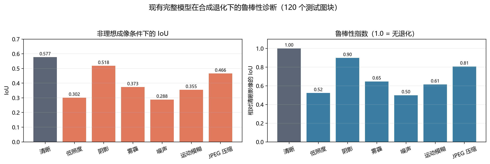
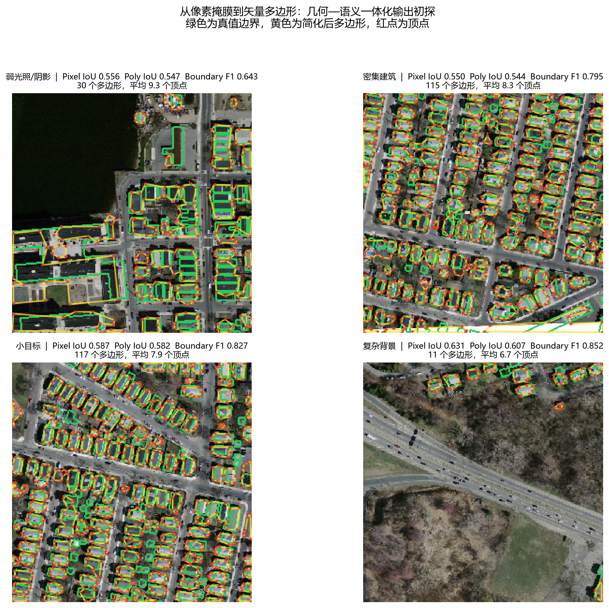

# 研究方向调整建议：从“网络复杂化”转向“问题定义与输出形式创新”

> 结论先行：**不建议继续在 U-Net 上叠加 ASPP、注意力、Transformer 等模块来追求零点几个 IoU。**  
> 建议把论文主线改为：**“非理想成像条件下的航拍建筑物鲁棒矢量提取”**。  
> 其中“鲁棒性”作为问题与评测主线，“几何—语义一体化”作为核心输出贡献。这样两个方向都能落地，但不会变成两个互不相干的硕士课题。

---

## 0. 为什么现在必须转向

前期的三组对照已经说明：在 1 m 分辨率、900 张图块、12 轮的 CPU 预算下，继续把 U-Net 做复杂，收益非常有限：

| 模型 | IoU | 边界 IoU | 小目标召回 | 粘连率 |
|---|---:|---:|---:|---:|
| U-Net 基线 | **0.5830** | 0.3653 | 0.6830 | 0.2042 |
| + ASPP | 0.5785 | 0.3629 | **0.6919** | **0.1821** |
| + ASPP + 边界监督 | **0.5830** | **0.3703** | 0.6870 | 0.1958 |

ASPP 让粘连率相对下降 10.8%，但总体 IoU 反而下降 0.77%；边界监督把边界 IoU 提升 1.4%，总体 IoU 仍与基线持平。Bootstrap 区间包含 0，**不能宣称显著提升**。

这说明：**当前瓶颈不在“网络容量”，而在训练数据的成像分布、以及“像素掩膜”这种输出形式本身。** 继续堆模块，只会得到更多“各有小优点、总体打平”的结果。

---

## 1. 两个方向各自的科学问题

### 方向 A：恶劣/非理想成像条件下的鲁棒提取

**不是**“多做几种数据增强”，而是回答：

> 当测试图像的退化类型、强度和组合方式未知，且与训练分布不同，如何在不增加主干复杂度的前提下保持建筑提取稳定？

先用现有完整模型做了一次合成退化压力测试（120 个测试图块，固定阈值 0.5）：

| 条件 | IoU | 相对清晰影像 | 边界 IoU | 小目标召回 |
|---|---:|---:|---:|---:|
| 清晰 | 0.5771 | 1.00 | 0.3669 | 0.6883 |
| 低照度 | 0.3017 | **0.52** | 0.2049 | 0.4079 |
| 阴影 | 0.5183 | 0.90 | 0.3198 | 0.6574 |
| 雾霾 | 0.3734 | 0.65 | 0.2600 | 0.5123 |
| 高斯噪声 | 0.2882 | **0.50** | 0.2390 | 0.3893 |
| 运动模糊 | 0.3548 | 0.61 | 0.2111 | 0.3598 |
| JPEG 压缩 | 0.4656 | 0.81 | 0.2538 | 0.5721 |

*图 A　现有完整模型在合成退化下的鲁棒性诊断。低照度和噪声使 IoU 直接减半，远大于 ASPP/边界模块带来的收益。*

这组结果足以支撑一个新的研究问题：**与其把干净影像的 IoU 从 0.583 提到 0.588，不如把低照度下的 0.302 提到 0.45–0.50。** 后者对灾害评估、夜间/阴天航拍、无人机巡检更有实际价值。

**可选的三个技术切口（建议选 1 个主切口，不要全做）：**

1. **退化感知的归一化与特征校准（推荐，轻量）**  
   从图像统计量（亮度、局部对比度、噪声方差、雾浓度）估计退化嵌入，用 FiLM/条件归一化调制浅层特征；不改变主干深度。  
   创新点在“退化条件显式建模”，不是“又加一个注意力”。

2. **干净—退化视图一致性学习**  
   同一图块构造 clean/corrupt 两个视图，教师—学生或双分支共享权重，约束预测一致；辅以阴影不变色度特征、光照重照明。  
   创新点在“无配对真实退化下的自监督约束”。

3. **测试时自适应（TTA/BN 统计校准/熵最小化）**  
   不重新训练，部署时用无标签测试图像做轻量适应；适合真实灾害场景的快速部署。  
   风险：批大小小、在线适应不稳定，需要约束。

**建议的组合：1 + 2 作为训练方法，3 作为部署验证。** 三者共享同一个“退化基准”，不会把论文拆散。

**必须建立的评测协议：**

- 6 类退化 × 3 个强度 + 2 种复合退化；
- 真实低照度/阴影子集（从原始数据中按亮度、阴影比例筛选，而不是全部合成）；
- 跨区域测试（不同城市/传感器）；
- 指标：Clean IoU、Corrupted IoU、**Robustness Index = IoU_corrupt / IoU_clean**、最差条件 IoU、ECE/不确定性校准；
- 报告均值 ± 标准差（至少 3 个 seed），不要再用单次结果下结论。

---

### 方向 B：从“像素分割”走向“几何—语义一体化输出”

**不是**“对 mask 做一次 findContours”，而是回答：

> 如何让网络直接输出可用于 GIS 的建筑多边形（含实例、孔洞、拓扑与置信度），而不是把分割错误原样传给后处理？

先做了一个“朴素矢量化”基线：阈值 0.5 → 连通域 → `approxPolyDP`（1.2% 周长）。四个典型场景：

| 场景 | Pixel IoU | Polygon IoU | Boundary F1 | 多边形数 | 平均顶点 |
|---|---:|---:|---:|---:|---:|
| 弱光照/阴影 | 0.556 | 0.547 | 0.643 | 30 | 9.3 |
| 密集建筑 | 0.550 | 0.544 | 0.795 | 115 | 8.3 |
| 小目标 | 0.587 | 0.582 | 0.827 | 117 | 7.9 |
| 复杂背景 | 0.631 | 0.607 | 0.852 | 11 | 6.7 |
| **平均** | **0.581** | **0.570** | **0.779** | — | **8.1** |

*图 B　朴素轮廓矢量化初探。绿色为真值边界，黄色为简化多边形，红点为顶点。*

两个关键发现：

1. **矢量化本身只损失约 1.1 个 IoU 点**，说明“像素→多边形”在几何上是可行的，难点不在轮廓拟合，而在**分割错误会被原样继承**（水面误检会变成多边形、粘连屋顶会变成一个多边形）。
2. **边界 F1 只有 0.779，且阴影场景只有 0.643**。这正是“几何—语义一体化”应该解决的问题：让网络在训练时就知道“边界、角点、实例、孔洞”是要被输出的，而不是只在像素上做二分类。

**可选的三个技术切口：**

1. **多任务几何表示（推荐，CPU 可行）**  
   在轻量主干上并联四个头：建筑 mask、边界、距离变换、实例嵌入；  
   距离变换提供“建筑中心—边缘”的几何场，实例嵌入负责分开相邻屋顶；  
   推理时用分水岭/连通域 + 轮廓简化得到多边形，输出 GeoJSON。  
   创新点在“几何场 + 实例分离 + 拓扑约束”，不是更大网络。

2. **学习式多边形/实例分割**  
   Polygon-RNN、Curve-GCN、HiSup、Mask2Former 等直接输出顶点或实例；效果好但训练重、CPU 不友好，适合作为对比方法或后续工作。

3. **语义属性与不确定性**  
   在矢量多边形上附加建筑类型、面积、置信度、孔洞/庭院标志；对低置信度建筑输出“待复核”，直接对接灾害评估/违建巡查流程。  
   这是“语义”的一半，能显著提升论文的系统价值。

**建议的组合：1 作为主方法，3 作为输出层；2 只作为文献对比，不在 CPU 上硬做大模型。**

**几何/语义指标（必须换掉“只看 IoU”）：**

- 像素级：IoU、F1；
- 边界级：Boundary F1、Hausdorff 距离；
- 多边形级：Polygon IoU、顶点数误差、简化损失；
- 实例级：AP、实例召回、粘连率、孔洞数量误差；
- 拓扑级：自交、重叠、悬挂边、闭合性；
- 语义/实用级：GeoJSON 可解析率、面积误差、置信度校准。

---

## 2. 推荐论文结构：一个主贡献 + 一个支撑贡献

题目建议：

> **《非理想成像条件下的航拍建筑物鲁棒矢量提取方法研究》**

这个题目把两个方向统一在“鲁棒 + 矢量”下，避免写成“U-Net 改进 + 轮廓后处理”的两张皮。

### 章节安排

| 章节 | 内容 | 定位 |
|---|---|---|
| 第 1 章 | 绪论、研究背景、国内外现状、本文工作 | — |
| 第 2 章 | 相关理论与评价体系：语义分割、边界/实例、矢量表达 | 基础 |
| 第 3 章 | **非理想成像退化建模与鲁棒性基准**：6 类退化、真实低照度子集、鲁棒性指数 | 支撑贡献 |
| 第 4 章 | **几何—语义一体化建筑提取**：mask + boundary + distance + embedding + 多边形化 | **主贡献** |
| 第 5 章 | 统一框架与实验：干净/退化/跨区域、消融、失败案例 | 整合 |
| 第 6 章 | 结论与展望 | — |

如果导师要求“两个创新点”，第 3 章和第 4 章可以各自作为一个创新点；但第 3 章不要写成“又训练一个抗退化网络”，而是“基准 + 退化感知的轻量适配”。

### 不建议的写法

- 把 ASPP 当创新点；
- 把“加了注意力/Transformer”当创新点；
- 把“findContours 得到多边形”当几何创新；
- 只在干净测试集上刷 0.5 个 IoU；
- 用 4 景验证集选阈值、单 seed 下结论。

---

## 3. 8 周执行计划（可按实际周数压缩）

| 周 | 方向 A（鲁棒） | 方向 B（几何） | 产出 |
|---|---|---|---|
| 1 | 固化 6 类退化 × 3 强度基准；真实低照度子集 | 复用现有 mask，搭 Polygon IoU / Boundary F1 / 拓扑指标 | 基准 v1 + 指标库 |
| 2 | 训练“干净 + 增强”基线，测 Robustness Index | 实现 mask+boundary+distance 三头基线 | 两组 baseline |
| 3 | 退化感知归一化 / 一致性学习 | 加实例嵌入 + 分水岭，输出多边形 | 方法 v1 |
| 4 | 消融：退化估计、一致性权重、TTA | 消融：距离头、边界头、实例头 | 消融表 |
| 5 | 复合退化 + 跨区域测试 | 多边形后处理与拓扑修正 | 鲁棒/几何结果 |
| 6 | 统一框架：在退化输入上评估矢量输出 | 同左 | 主结果 |
| 7 | 失败案例、可视化、GeoJSON 导出 | 同左 | 图表 |
| 8 | 论文写作、PPT 重做 | 同左 | 定稿 |

**最小可行版本（如果时间不足）：**

- 方向 A：只做“退化基准 + 退化感知归一化”；
- 方向 B：只做“mask + boundary + distance 三头 + 轮廓多边形 + Polygon IoU”；
- 两者在同一个测试协议下合并，就足以支撑一篇本科毕业论文。

---

## 4. 立即可以做的下一步

### 如果选方向 A（鲁棒）
1. 把当前的 7 种条件扩展为 6 类 × 3 强度，并加入“低照度 + 噪声”“阴影 + 模糊”复合退化；
2. 训练一个“干净 + 退化增强”的对照模型；
3. 实现退化感知归一化（从图像统计量估计退化向量，FiLM 调制前两层）；
4. 报告 Clean IoU、Corrupted IoU、Robustness Index、最差条件 IoU。

### 如果选方向 B（几何）
1. 在现有 U-Net 上增加 boundary + distance transform 两个辅助头（不换主干）；
2. 用距离变换 + 分水岭把粘连屋顶分开；
3. 对实例轮廓做多边形简化与拓扑检查，导出 GeoJSON；
4. 报告 Pixel IoU、Boundary F1、Polygon IoU、实例 AP、粘连率、拓扑错误数。

### 如果两个都做（推荐）
先做方向 A 的基准（1 周），再做方向 B 的主方法（3 周），最后在退化测试集上统一评估“鲁棒矢量输出”。这样论文的故事是完整的：

> **非理想成像 → 鲁棒分割 → 几何—语义一体化 → 可用矢量成果**

而不是：

> **U-Net → 加 ASPP → 加边界 → IoU 没涨 → 再加模块**

---

## 5. 需要你确认的一个选择

我建议主攻 **方向 B（几何—语义一体化）**，把 **方向 A（鲁棒性）作为第 3 章的基准与评测主线**。理由：

- 几何—语义一体化有明确的“新输出形式”，容易做出可展示的差异（矢量多边形、实例、孔洞、GeoJSON），不像 IoU 涨 0.5 那样难以证明；
- 当前 CPU 环境完全够用：不需要大模型，只需要小任务头 + 后处理；
- 鲁棒性作为评测维度，可以复用同一套模型和指标，不会把论文拆成两个课题；
- 两者结合后的题目“鲁棒矢量提取”逻辑自洽，答辩时也容易讲清楚。

如果你更希望“恶劣成像”作为第一创新点，也可以把第 3 章升级为主贡献、第 4 章作为输出增强；但不建议两章都做成“新网络”。

**下一步我可以直接做的是：**
1. 按方向 A 搭完整退化基准 + 训练退化感知模型；或
2. 按方向 B 加 boundary/distance/instance 头 + 多边形化 + GeoJSON 导出；或
3. 先重做一版新的论文汇报 PPT，把主线从“ASPP 消融”改成“鲁棒 + 矢量”。

你确认优先级后，我就按新主线继续实验和改 PPT。
